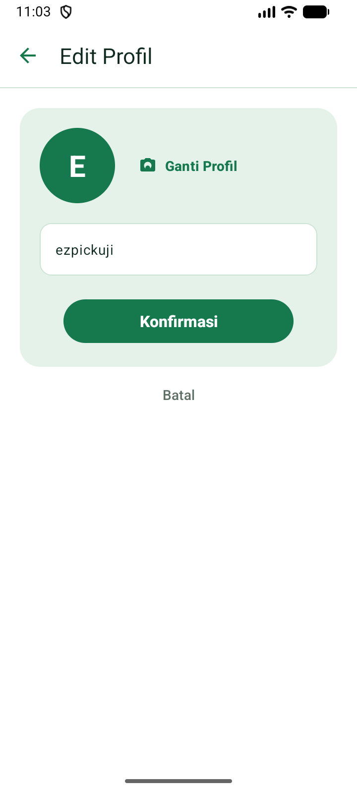
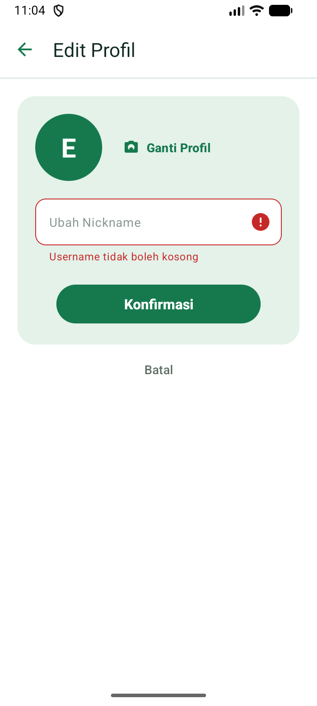
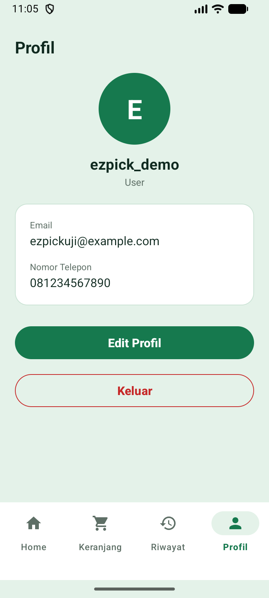

# Toko-Online-Umkm

Repository kumpulan tugas magang di Crocodic Semarang untuk aplikasi **Toko Online UMKM Semarang (EZPICK)**. Branch ini berisi **Tugas 3**.

Seluruh tangkapan layar pada dokumen ini diambil langsung dari aplikasi yang sudah berjalan, memakai REST API yang sebenarnya.

---

# Branch `Tugas 3 – Implementasi API: Halaman Profil Pengguna dan Edit Profil`

## Deskripsi

Melanjutkan aplikasi **Toko Online UMKM Semarang (EZPICK)** dengan melengkapi fitur **Profil**. Pada Tugas 2 halaman Profil baru bisa **menampilkan** data pengguna. Pada Tugas 3 pengguna dapat **mengubah** datanya melalui halaman **Edit Profil**, yaitu mengganti **nickname (username)** dan **foto profil (avatar)**.

Seluruh prosesnya tetap memakai **REST API**, **MVVM**, dan **Repository Pattern** yang sama seperti tugas sebelumnya, serta backend lokal `db_toko_online` yang sudah dibuat di Tugas 2. Tidak ada struktur tabel yang diubah: kolom `username` dan `avatar` memang sudah tersedia pada tabel `users`.

## Ketentuan Fitur

- Menampilkan data profil (nama, email, nomor telepon, foto) dari REST API memakai method **GET**.
- Mengubah profil memakai method **POST** (`multipart/form-data`) karena ada kemungkinan mengunggah file foto.
- Memakai **MVVM + Repository**: Activity/Fragment hanya menampilkan data, ViewModel mengatur validasi dan status, Repository satu-satunya yang berkomunikasi dengan API Service.
- **Validasi** nickname sebelum request dikirim (tidak boleh kosong, minimal 3 karakter), dan divalidasi ulang di sisi server.
- Menampilkan **indikator loading** saat memuat dan menyimpan, serta **menonaktifkan tombol** selama proses berlangsung agar tidak terkirim ganda.
- Menangani **berhasil** dan **gagal** dengan pesan yang dibaca dari respons server, bukan teks buatan aplikasi.
- **Memperbarui halaman Profil** secara otomatis setelah perubahan berhasil disimpan.
- Tidak memakai data dummy; seluruh data berasal dari database lewat API.

## Endpoint yang Ditambahkan

Seluruh alamat diawali `/api` dan mengikuti bentuk respons yang sama seperti endpoint lain (`{ status, message, data }`).

| Method | Endpoint | Fungsi |
|---|---|---|
| GET | `/api/users/{id}` | Mengambil data profil (sudah ada sejak Tugas 2, kini ikut mengirim `avatar`) |
| POST | `/api/users/{id}` | **Baru.** Memperbarui profil: `username` (wajib) dan `avatar` (file, opsional) |

Ketentuan `POST /api/users/{id}`:

- Dikirim sebagai `multipart/form-data` dengan field `username` dan—bila ingin mengganti foto—field file `avatar`.
- Kalau `avatar` tidak dikirim, foto profil lama dipertahankan.
- Validasi server: `username` wajib diisi (422), minimal 3 karakter (422), dan tidak boleh sama dengan milik pengguna lain (409 karena kolom `username` bersifat UNIQUE).
- File avatar divalidasi sebagai gambar (JPG/PNG/WEBP) dan dibatasi maksimal 2 MB, lalu disimpan di `backend/public/uploads/avatars/`. Path relatifnya (mis. `uploads/avatars/avatar_1_1699999999.png`) disimpan di kolom `avatar`.
- File avatar dilayani sebagai berkas statis di luar `/api`, contoh: `http://10.0.2.2:3000/uploads/avatars/avatar_1_1699999999.png`.

## Alur

**Menampilkan profil**

```
ProfileFragment → ProfileViewModel → UserRepository → GET /api/users/{id} → MySQL
      ^                                                                      |
      +------------------ data profil ditampilkan --------------------------+
```

Data sesi (SharedPreferences) ditampilkan lebih dulu agar layar tidak kosong, lalu diperbarui dengan data terbaru dari API. Foto profil diunduh di latar belakang; selama belum ada foto, ditampilkan **huruf awal nama** di dalam lingkaran hijau.

**Edit profil**

```
Tombol "Edit Profil" → EditProfileActivity (form terisi data lama)
      → pengguna ubah nickname / pilih foto
      → validasi di EditProfileViewModel
      → UserRepository → POST /api/users/{id} (multipart) → MySQL
          ├─ Berhasil: sesi diperbarui, Activity ditutup, halaman Profil dimuat ulang
          └─ Gagal: pesan server ditampilkan, input pengguna dipertahankan
```

## File yang Ditambahkan / Diubah

**Backend**

- `backend/models/User.php` — tambah `perbarui()` dan `usernameDipakaiPenggunaLain()`.
- `backend/controllers/UserController.php` — tambah `perbarui()` beserta penyimpanan avatar yang aman.
- `backend/routes/api.php` — `POST /api/users/{id}` diarahkan ke `perbarui()`.
- `backend/public/uploads/avatars/` — folder penyimpanan foto (file hasil unggah tidak ikut di-commit).

**Android**

- `data/network/ResponseModels.kt` — tambah field `avatar` pada model `User`.
- `data/network/ApiConfig.kt` — tambah `SERVER_URL` untuk menyusun URL foto.
- `data/network/ApiService.kt` — tambah `updateProfile()` (multipart) dan `unduhGambar()`.
- `data/repository/UserRepository.kt` — tambah `perbaruiProfil()`, `unduhAvatar()`, dan menyimpan `avatar` pada sesi.
- `ui/profile/ProfileFragment.kt` & `ProfileViewModel.kt` — tampilan Profil baru (avatar, nama, label User) + tombol Edit Profil + muat ulang setelah edit.
- `ui/editprofile/EditProfileActivity.kt` & `EditProfileViewModel.kt` — **baru**, halaman Edit Profil.
- `res/layout/fragment_profil.xml`, `res/layout/activity_edit_profile.xml`, beberapa drawable/style/string, dan pendaftaran Activity di `AndroidManifest.xml`.

## Penanganan Kondisi

| Kondisi | Yang ditampilkan |
|---|---|
| Sedang memuat / menyimpan | Indikator loading, tombol dinonaktifkan |
| Berhasil disimpan | Pesan dari server, halaman Profil diperbarui |
| Nickname kosong / terlalu pendek | Pesan validasi tepat di bawah kolom |
| Nickname sudah dipakai pengguna lain | Pesan dari server (HTTP 409) |
| File bukan gambar / lebih dari 2 MB | Pesan dari server (HTTP 422) |
| Koneksi bermasalah / server tidak terjangkau | Pesan yang mudah dipahami, aplikasi tetap berjalan |

Kalau penyimpanan gagal, aplikasi **tidak** menampilkan pesan berhasil dan **tidak** mengubah data profil seolah-olah sudah tersimpan.

## Cara Menguji

1. Jalankan MySQL dan backend (`php -S 0.0.0.0:3000 -t backend/public` — pakai `0.0.0.0` supaya bisa diakses dari emulator/HP Android).
2. Jalankan aplikasi, login, lalu buka tab **Profil**.
3. Tekan **Edit Profil**, ubah nickname dan/atau tekan **Ganti Profil** untuk memilih foto, lalu tekan **Konfirmasi**.
4. Setelah berhasil, aplikasi kembali ke halaman Profil dengan data yang sudah diperbarui.

Endpoint juga bisa diuji lewat Postman dengan request `POST {{base_url}}/api/users/1`, tipe body `form-data`, field `username` (text) dan `avatar` (file, opsional).

## Tangkapan Layar

Seluruh gambar diambil dari aplikasi yang berjalan di emulator dan terhubung ke backend lokal, sehingga data benar-benar berasal dari database `db_toko_online`.

| 23 — Profil User | 24 — Edit Profil |
|:---:|:---:|
|  |  |
| Data pengguna hasil `GET /api/users/{id}`: foto profil (huruf awal nama), nama, label "User", email, dan nomor telepon, beserta tombol Edit Profil dan Keluar | Form Edit Profil terisi data lama. Tersedia tombol **Ganti Profil** untuk mengganti foto, kolom **Ubah Nickname**, serta tombol **Konfirmasi** dan **Batal** |

| 25 — Validasi Edit Profil | 26 — Profil Setelah Diperbarui |
|:---:|:---:|
|  |  |
| Nickname dikosongkan lalu Konfirmasi ditekan. Kolom ditandai merah dengan pesan "Username tidak boleh kosong", dan permintaan tidak dikirim ke API | Setelah nickname diubah dan disimpan lewat `POST /api/users/{id}`, halaman Profil otomatis menampilkan nama yang baru |
