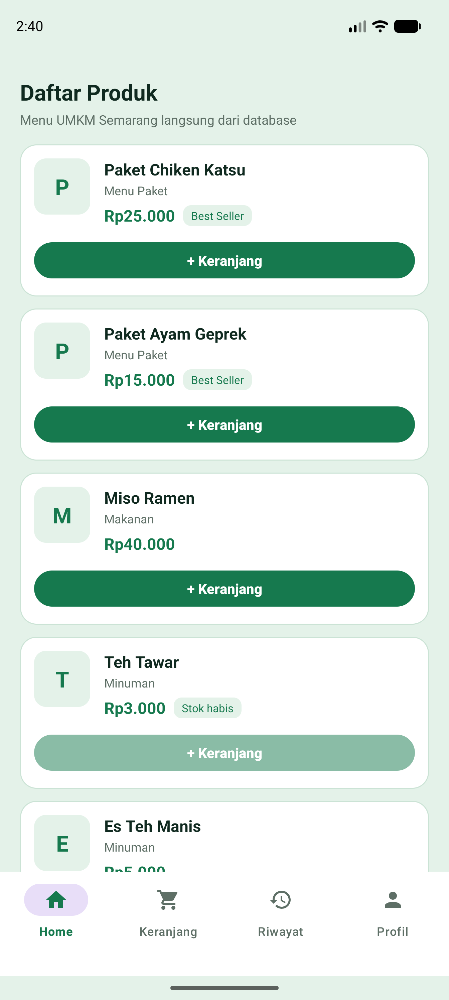
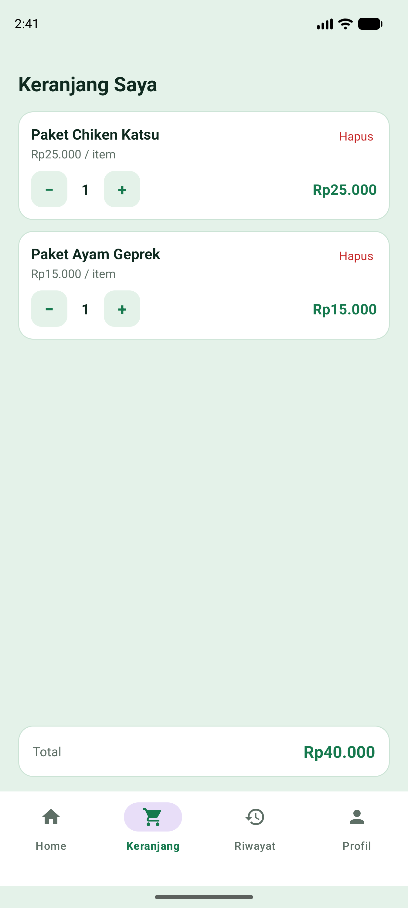
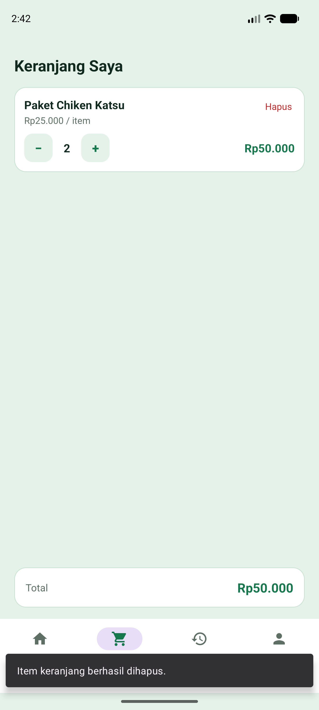
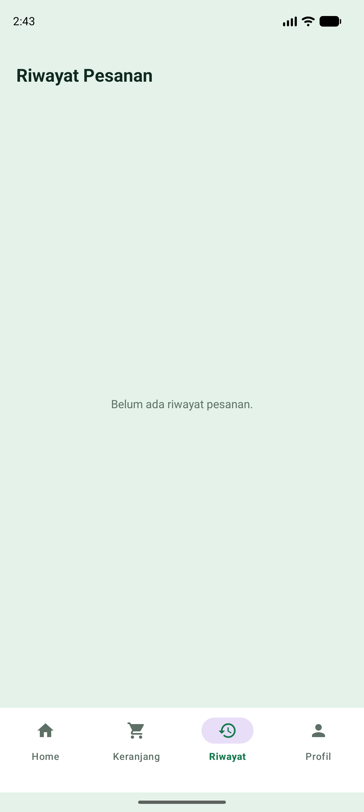
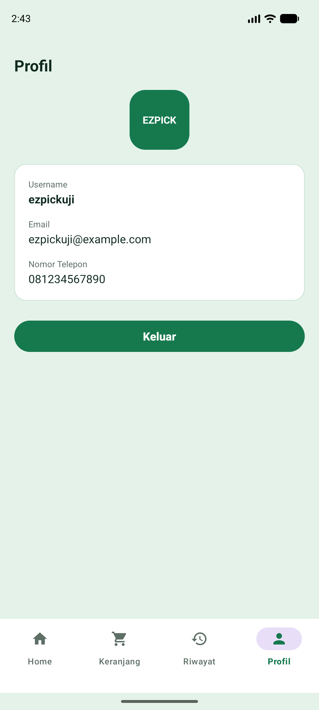
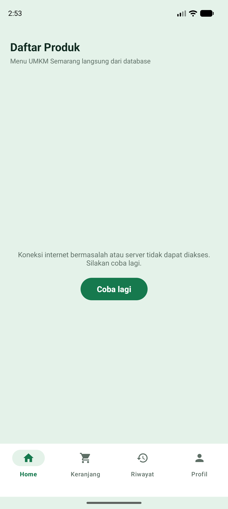
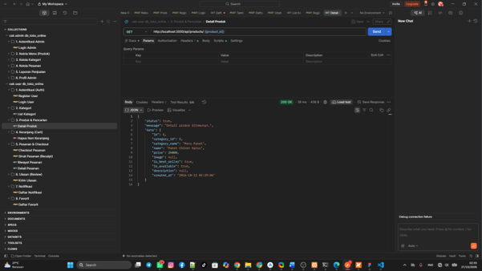

# Toko-Online-Umkm

Repository kumpulan tugas magang di Crocodic Semarang untuk aplikasi **Toko Online UMKM Semarang (EZPICK)**. Branch ini berisi **Tugas 2**.

Seluruh tangkapan layar pada dokumen ini diambil langsung dari aplikasi yang sudah berjalan, memakai REST API yang sebenarnya.

---

# Branch `Tugas 2 – Implementasi Backend REST API dan Bottom Navigation Aplikasi Toko Online`

## Deskripsi

Melanjutkan pengembangan aplikasi **Toko Online UMKM Semarang (EZPICK)**. Pada Tugas 1 aplikasi masih memakai REST API milik orang lain yang sudah jadi, dan setelah Login hanya ada satu halaman Dashboard berisi data akun.

Pada tugas ini dibuat **backend REST API sendiri** yang berjalan di komputer lokal dan terhubung langsung ke database MySQL **`db_toko_online`**. Aplikasi Android kemudian diarahkan ke backend tersebut, sehingga data yang tampil di layar benar-benar berasal dari tabel MySQL, bukan data dummy.

Halaman Dashboard yang tadinya hanya satu layar diubah menjadi wadah berisi **Bottom Navigation** dengan empat menu: **Home**, **Keranjang**, **Riwayat**, dan **Profil**. Masing-masing menu adalah sebuah Fragment yang mengambil datanya sendiri lewat REST API.

Seluruh pengerjaan dilakukan **tanpa mengubah database sama sekali**. Tidak ada tabel yang dibuat, diubah, dihapus, maupun direset. Backend menyesuaikan diri dengan nama tabel dan nama kolom yang sudah ada.

## Ketentuan Fitur

- Membuat **backend REST API** yang berjalan di **localhost** dan terhubung ke MySQL `db_toko_online`.
- Memakai **JSON** sebagai format pertukaran data dengan bentuk respons yang konsisten.
- **Memvalidasi setiap request** sebelum diproses, dan menangani error koneksi database, input tidak valid, serta data yang tidak ditemukan.
- Mengirim **HTTP status code** yang sesuai untuk setiap keadaan.
- Membuat **Collection Postman** bernama `Toko Online UMKM Semarang API` untuk menguji seluruh endpoint, termasuk kondisi berhasil dan gagal.
- **Mengintegrasikan REST API** dengan aplikasi Android memakai pola MVVM + Repository yang sudah dipakai pada Tugas 1.
- Membuat **Bottom Navigation** dengan ikon dan label yang jelas, serta tampilan berbeda untuk menu yang sedang aktif.
- Menampilkan **indikator loading**, **pesan berhasil/gagal**, serta menangani **data kosong** dan **server yang tidak dapat diakses**.
- **Tidak mengubah struktur maupun data database** yang sudah tersedia.

## Memeriksa Struktur Database Lebih Dulu

Sebelum satu baris kode backend ditulis, struktur database diperiksa dulu memakai operasi baca saja (`SHOW TABLES`, `SHOW FULL COLUMNS`, dan `information_schema`). Hasilnya dipakai sebagai acuan penulisan query, sehingga tidak ada nama tabel atau nama kolom yang ditebak.

Database `db_toko_online` berisi **10 tabel**:

| Tabel | Isi | Kolom utama |
|---|---|---|
| `users` | Akun pengguna | `id`, `username`, `email`, `password`, `no_tlp`, `created_at`, `avatar` |
| `admins` | Akun admin | `id`, `username`, `password`, `nickname`, `avatar`, `created_at` |
| `categories` | Kategori menu | `id`, `name`, `icon`, `sort_order` |
| `products` | Daftar produk | `id`, `category_id`, `name`, `price`, `image`, `is_best_seller`, `is_available`, `description`, `created_at` |
| `carts` | Keranjang belanja | `id`, `user_id`, `product_id`, `quantity`, `notes`, `created_at` |
| `orders` | Pesanan | `id`, `user_id`, `order_type`, `payment_method`, `total_amount`, `status`, `pickup_location`, `notes`, `created_at`, dan lainnya |
| `order_items` | Isi setiap pesanan | `id`, `order_id`, `product_id`, `quantity`, `price`, `subtotal` |
| `reviews` | Ulasan pesanan | `id`, `order_id`, `user_id`, `product_id`, `rating`, `comment`, `tags`, `created_at` |
| `favorites` | Produk favorit | `id`, `user_id`, `product_id`, `created_at` |
| `notifications` | Notifikasi pengguna | `id`, `user_id`, `message`, `created_at` |

Relasi antartabel yang ditemukan:

```
categories ──< products ──< carts >── users
                   │          
                   ├──< order_items >── orders >── users
                   │
                   ├──< favorites >── users
                   │
                   └──< reviews >── orders, users

users ──< notifications
```

Kolom `password` pada `users` dan `admins` berisi hash **bcrypt** (`$2y$10$...`). Karena itu backend memakai `password_hash()` dan `password_verify()` bawaan PHP, mengikuti bentuk data yang memang sudah ada — bukan membuat cara penyimpanan password yang baru.

## Backend REST API

Backend ditulis memakai **PHP native** tanpa framework dan tanpa dependency, supaya setiap bagiannya mudah dibaca ulang. Koneksi database memakai **PDO** dengan **prepared statement**.

```
backend/
├── config/
│   ├── env.php          Membaca file .env menjadi array
│   ├── database.php     Membuat koneksi PDO ke MySQL
│   └── response.php     Bentuk respons JSON dan pembaca input request
├── models/              Query SQL per tabel
├── controllers/         Validasi request lalu memanggil Model
├── routes/api.php       Daftar seluruh endpoint
└── public/index.php     Pintu masuk tunggal, seluruh request lewat sini
```

Alur satu request:

```
Request  →  public/index.php  →  routes/api.php  →  Controller  →  Model  →  MySQL
                                                                      ↓
Response JSON  ←───────────────────────────────────────────────── hasil query
```

Pembagian tugasnya sengaja dibuat mirip dengan susunan MVVM di sisi Android: **Controller** hanya mengurus validasi dan bentuk respons, sedangkan **Model** satu-satunya bagian yang menulis query SQL.

Penjelasan lengkap cara menjalankan dan konfigurasinya ada pada [`backend/README.md`](backend/README.md).

## Daftar Endpoint

Seluruh alamat diawali `/api`.

| Method | Endpoint | Fungsi |
|---|---|---|
| GET | `/api` | Cek backend hidup |
| POST | `/api/auth/register` | Mendaftarkan akun baru |
| POST | `/api/auth/login` | Masuk dengan akun terdaftar |
| GET | `/api/categories` | Daftar kategori |
| GET | `/api/products` | Daftar produk (filter `category_id`, `search`, `best_seller`) |
| GET | `/api/products/{id}` | Detail satu produk |
| GET | `/api/carts?user_id=` | Isi keranjang satu pengguna |
| POST | `/api/carts` | Menambah produk ke keranjang |
| PUT | `/api/carts/{id}` | Mengubah jumlah item keranjang |
| DELETE | `/api/carts/{id}` | Menghapus item keranjang |
| GET | `/api/orders?user_id=` | Riwayat pesanan satu pengguna |
| GET | `/api/orders/{id}` | Detail satu pesanan |
| GET | `/api/users/{id}` | Data pengguna untuk halaman Profil |

### Mengapa produk hanya bisa dibaca

Tabel `products` sudah berisi katalog yang disiapkan sebelumnya, dan aturan tugas melarang mengubah data yang sudah ada. Karena itu endpoint produk sengaja dibuat **hanya membaca**.

Method `POST`, `PUT`, dan `DELETE` tetap dibuat lengkap, tetapi ditempatkan pada **keranjang** — fitur yang datanya memang dibuat dan dihapus sendiri oleh pengguna. Dengan begitu keempat method HTTP tetap dipakai pada fitur yang nyata, tanpa satu pun data lama yang terganggu.

## Bentuk Respons dan HTTP Status Code

Seluruh endpoint memakai bentuk yang sama, sehingga aplikasi Android cukup membaca satu pola.

```json
{
  "status": true,
  "message": "Daftar produk berhasil diambil.",
  "data": [ ... ]
}
```

```json
{
  "status": false,
  "message": "Produk tidak ditemukan."
}
```

| Kode | Dipakai ketika |
|---|---|
| `200 OK` | Permintaan berhasil |
| `201 Created` | Data baru berhasil dibuat |
| `401 Unauthorized` | Username atau password salah |
| `404 Not Found` | Data atau endpoint tidak ditemukan |
| `405 Method Not Allowed` | Method HTTP tidak sesuai untuk endpoint tersebut |
| `409 Conflict` | Username atau email sudah terdaftar |
| `422 Unprocessable Entity` | Input tidak valid atau wajib diisi |
| `500 Internal Server Error` | Kesalahan tak terduga pada server |
| `503 Service Unavailable` | Backend tidak dapat terhubung ke MySQL |

## Keamanan Backend

- Seluruh query memakai **prepared statement**, sehingga aman dari SQL injection.
- **Tidak ada** perintah `CREATE`, `ALTER`, `DROP`, atau `TRUNCATE` di dalam kode backend. Tidak ada migration dan tidak ada seeder.
- Password disimpan sebagai hash dan dicocokkan dengan `password_verify()`. Kolom `password` tidak pernah ikut dikirim pada respons mana pun.
- Pesan gagal login sengaja disamakan ("Username atau password salah.") supaya tidak membocorkan username mana yang terdaftar.
- `display_errors` dimatikan. Kesalahan internal hanya dicatat lewat `error_log`, sedangkan yang diterima pengguna hanya pesan yang mudah dipahami. Nama database, username, dan password tidak pernah ikut terkirim.
- Kredensial database disimpan pada `backend/.env` yang sudah didaftarkan pada `.gitignore`. Yang ikut terunggah ke GitHub hanya `backend/.env.example`.

## Bottom Navigation

`DashboardActivity` tidak lagi berisi tampilan sendiri. Sekarang Activity tersebut hanya menjadi **wadah**, isinya ditentukan oleh Fragment yang dipilih lewat Bottom Navigation.

```
DashboardActivity
├── FragmentContainerView     ← isinya berganti sesuai menu yang dipilih
└── BottomNavigationView
        ├── Home        →  HomeFragment      daftar produk dari API
        ├── Keranjang   →  CartFragment      isi keranjang + ubah jumlah + hapus
        ├── Riwayat     →  HistoryFragment   riwayat pesanan dari API
        └── Profil      →  ProfileFragment   data akun + tombol Keluar
```

- Setiap menu punya **ikon dan label** yang jelas.
- Menu yang sedang aktif ditandai **ikon dan teks berwarna hijau** beserta latar hijau muda, memakai `app:itemIconTint`, `app:itemTextColor`, dan `app:itemActiveIndicatorStyle`.
- Perpindahan halaman memakai `supportFragmentManager` biasa, tanpa menambah library Navigation Component, supaya alurnya tetap mudah diikuti.
- Tidak ada menu yang dibuat tanpa fungsi. Keempat menu benar-benar mengambil data dari endpoint yang sudah diuji lewat Postman.

## Integrasi dengan Aplikasi Android

Pola MVVM + Repository dari Tugas 1 diteruskan apa adanya, hanya ditambah Repository dan ViewModel baru sesuai halamannya.

```
Fragment  →  ViewModel  →  Repository  →  REST API  →  MySQL
   ↑                                                      │
   └──────────── LiveData ←── respons JSON ───────────────┘
```

| Halaman | ViewModel | Repository | Endpoint |
|---|---|---|---|
| Home | `HomeViewModel` | `ProductRepository`, `CartRepository` | `GET /api/products`, `POST /api/carts` |
| Keranjang | `CartViewModel` | `CartRepository` | `GET/PUT/DELETE /api/carts` |
| Riwayat | `HistoryViewModel` | `OrderRepository` | `GET /api/orders` |
| Profil | `ProfileViewModel` | `UserRepository` | `GET /api/users/{id}` |

Fragment tidak pernah memanggil API secara langsung. Fragment hanya mengamati `LiveData` milik ViewModel, lalu menampilkan apa pun yang dikirimkan.

Pesan error dari seluruh Repository dikumpulkan pada satu tempat, yaitu `PesanApi`, supaya pesan yang muncul di aplikasi selalu sama bentuknya dan tidak ditulis berulang di banyak file.

## Alamat Backend pada Aplikasi

Alamat backend disimpan pada satu tempat saja, yaitu `BASE_URL` di dalam `ApiConfig.kt`.

| Diakses dari | Alamat |
|---|---|
| Postman / browser di komputer yang sama | `http://localhost:3000/api/` |
| Android Emulator | `http://10.0.2.2:3000/api/` |
| HP Android fisik (satu jaringan Wi-Fi) | `http://<IP-lokal-komputer>:3000/api/` |

Karena backend lokal memakai **HTTP biasa**, sedangkan Android memblokir HTTP sejak Android 9, dibuat `res/xml/network_security_config.xml` yang membuka izin **hanya untuk alamat pengembangan** tersebut. Alamat selain yang terdaftar tetap wajib HTTPS, sehingga kelonggaran ini tidak berlaku untuk aplikasi produksi.

> **Kalau aplikasi menampilkan pesan koneksi gagal padahal backend sudah jalan:** pada sebagian emulator alamat `10.0.2.2` tidak bisa dipakai karena jaringan Wi-Fi dan jaringan seluler bawaan emulator berada pada subnet yang sama. Solusinya ganti `BASE_URL` dengan IP lokal komputer (lihat dengan `ipconfig`), lalu daftarkan IP tersebut pada `network_security_config.xml`.

## Penanganan Kondisi

| Kondisi | Yang ditampilkan aplikasi |
|---|---|
| Sedang mengambil data | `ProgressBar` di tengah halaman |
| Data berhasil diambil | Daftar isi halaman |
| Data kosong | Pesan "Belum ada produk yang tersedia." / "Keranjang masih kosong." / "Belum ada riwayat pesanan." |
| Backend mati atau tidak terjangkau | Pesan "Koneksi internet bermasalah atau server tidak dapat diakses." beserta tombol **Coba lagi** |
| MySQL mati | Pesan dari backend: "Server tidak dapat terhubung ke database. Pastikan MySQL sudah berjalan." |
| Respons tidak sesuai harapan | Pesan "Respons dari server tidak sesuai." |
| Berhasil menambah / mengubah / menghapus keranjang | **Snackbar** berisi pesan yang dikirim server |
| Produk sedang habis | Label "Stok habis" dan tombol tambah dinonaktifkan |
| Jumlah item dikurangi sampai nol | Snackbar "Jumlah minimal 1. Gunakan tombol hapus untuk membuang item." |

Pesan gagal yang tampil **dibaca dari respons server**, bukan teks yang dikarang aplikasi. Untuk respons dengan kode 4xx, pesannya diambil dari `errorBody()`.

## Menguji API dengan Postman

1. Pastikan MySQL dan backend sudah berjalan.
2. Import file `postman/Toko-Online-UMKM-Semarang.postman_collection.json` ke Postman. Berkas `Tugas-1-EZPICK-API.postman_collection.json` di folder yang sama adalah koleksi milik Tugas 1, bukan yang ini.
3. Periksa variable `base_url` pada tab **Variables**, nilainya `http://localhost:3000`.
4. Jalankan folder secara berurutan dari atas.

Collection berisi **28 request** dalam 7 folder, lengkap dengan pengujian untuk kondisi berhasil maupun gagal:

| Folder | Isi |
|---|---|
| 0. Cek Backend | Memastikan backend hidup |
| 1. Autentikasi | Register dan Login, beserta kondisi gagalnya |
| 2. Kategori | Daftar kategori |
| 3. Produk | Daftar, filter, pencarian, detail, dan ID yang tidak valid |
| 4. Keranjang | GET, POST, PUT, DELETE beserta kondisi gagalnya |
| 5. Pesanan | Riwayat dan detail pesanan |
| 6. Pengguna | Data pengguna untuk halaman Profil |

Setiap request memiliki **test script** yang memeriksa HTTP status code dan isi respons, sehingga hasilnya langsung terlihat pada tab **Test Results**.

Folder **Keranjang** disusun agar aman: request `POST` membuat satu baris keranjang baru dan menyimpan ID-nya ke variable `{{cart_id}}`, request `PUT` dan `DELETE` hanya bekerja pada baris tersebut, dan request terakhir menghapusnya kembali. Setelah seluruh folder dijalankan, isi database kembali seperti semula. Collection ini juga tidak menyimpan password maupun kredensial database.

## Struktur Folder

```
TokoOnlineUmkm/
├── backend/                                    ← backend REST API (baru)
│   ├── config/
│   ├── controllers/
│   ├── models/
│   ├── routes/
│   ├── public/
│   ├── .env.example
│   └── README.md
├── app/src/main/
│   ├── java/com/faizalwiyatnodito/tokoonlineumkm/
│   │   ├── data/
│   │   │   ├── network/
│   │   │   │   ├── ApiConfig.kt                ← diarahkan ke backend lokal
│   │   │   │   ├── ApiService.kt               ← endpoint produk, keranjang, pesanan, profil
│   │   │   │   └── ResponseModels.kt           ← model Product, Cart, Order, dan lainnya
│   │   │   └── repository/
│   │   │       ├── UserRepository.kt
│   │   │       ├── ProductRepository.kt        ← baru
│   │   │       ├── CartRepository.kt           ← baru
│   │   │       ├── OrderRepository.kt          ← baru
│   │   │       └── PesanApi.kt                 ← pesan error dipakai bersama
│   │   ├── ui/
│   │   │   ├── dashboard/DashboardActivity.kt  ← kini wadah Bottom Navigation
│   │   │   ├── home/                           ← HomeFragment, HomeViewModel, ProductAdapter
│   │   │   ├── cart/                           ← CartFragment, CartViewModel, CartAdapter
│   │   │   ├── history/                        ← HistoryFragment, HistoryViewModel, OrderAdapter
│   │   │   ├── profile/                        ← ProfileFragment, ProfileViewModel
│   │   │   ├── login/
│   │   │   └── register/
│   │   ├── util/Format.kt                      ← format rupiah dan tanggal
│   │   └── MainActivity.kt
│   └── res/
│       ├── layout/                             ← fragment_home, fragment_keranjang, item_product, dan lainnya
│       ├── menu/menu_bottom_nav.xml
│       └── xml/network_security_config.xml
└── postman/
    ├── Toko-Online-UMKM-Semarang.postman_collection.json   ← koleksi Tugas 2 (localhost)
    └── Tugas-1-EZPICK-API.postman_collection.json          ← koleksi Tugas 1 (API publik)
```

## Teknologi

| Bagian | Teknologi |
|---|---|
| Backend | PHP 8 native, PDO (prepared statement) |
| Database | MySQL / MariaDB (`db_toko_online`) |
| Pengujian API | Postman Collection v2.1 |
| Aplikasi | Kotlin, MVVM + Repository Pattern |
| Jaringan | Retrofit 2 + Gson + OkHttp Logging Interceptor |
| Tampilan | ViewBinding, ConstraintLayout, RecyclerView, Material 3 BottomNavigationView |

## Cara Menjalankan

1. Nyalakan **MySQL** lewat XAMPP Control Panel, pastikan database `db_toko_online` tersedia.
2. Salin `backend/.env.example` menjadi `backend/.env`, lalu sesuaikan isinya.
3. Jalankan backend dari folder project:

   ```bash
   C:\xampp\php\php.exe -S 0.0.0.0:3000 -t backend/public backend/public/index.php
   ```

4. Cek `http://localhost:3000/api` di browser, pastikan responsnya `"status": true`.
5. Uji endpoint lewat Collection Postman.
6. Sesuaikan `BASE_URL` pada `ApiConfig.kt` dengan perangkat yang dipakai, lalu jalankan aplikasi Android.
7. Daftar akun baru lewat halaman Register, lalu Login memakai akun tersebut.

## Tangkapan Layar

Seluruh gambar di bawah diambil dari aplikasi yang sedang berjalan dan terhubung ke backend lokal, sehingga isinya benar-benar berasal dari database `db_toko_online`.

| 16 — Home | 17 — Keranjang |
|:---:|:---:|
|  |  |
| Daftar produk hasil `GET /api/products`. Label "Best Seller" dan "Stok habis" mengikuti kolom `is_best_seller` dan `is_available` | Isi keranjang hasil `GET /api/carts`, beserta total harga yang dihitung backend |

| 18 — Ubah dan Hapus Keranjang | 19 — Riwayat Kosong |
|:---:|:---:|
|  |  |
| Jumlah diubah lewat `PUT /api/carts/{id}` dan satu item dihapus lewat `DELETE /api/carts/{id}`. Snackbar menampilkan pesan yang dikirim server | Akun baru belum punya pesanan, sehingga ditampilkan pesan data kosong, bukan layar kosong |

| 20 — Profil | 21 — Server Tidak Dapat Diakses |
|:---:|:---:|
|  |  |
| Data akun hasil `GET /api/users/{id}`. Kolom password tidak pernah ikut dikirim | Backend tidak terjangkau. Aplikasi menampilkan pesan yang mudah dipahami beserta tombol **Coba lagi**, dan tetap berjalan |

### Pengujian Endpoint di Postman

| 22 — Uji Endpoint di Postman |
|:---:|
|  |
| Request `GET /api/products/1` (Detail Produk) dijalankan dari Collection `cek user db_toko_online`. Respons `200 OK` menampilkan data "Paket Chiken Katsu" yang diambil langsung dari tabel `products` pada database `db_toko_online`. |

## Catatan

- Backend memakai **PHP native** karena MySQL yang dipakai sudah berada di dalam XAMPP, sehingga PHP-nya tinggal dipakai tanpa perlu memasang apa pun. Tanpa framework, seluruh alurnya terlihat jelas dari `index.php` sampai query SQL-nya.
- Backend dijalankan memakai **PHP built-in server** (`php -S`), bukan Apache, supaya kode backend bisa tetap berada di dalam repository dan dijalankan dengan satu perintah tanpa mengubah konfigurasi Apache. File `.htaccess` tetap disertakan bagi yang ingin menjalankannya lewat Apache.
- Alamat `0.0.0.0` dipakai saat menjalankan backend supaya dapat diakses dari komputer sendiri maupun dari perangkat Android pada jaringan yang sama. Kalau memakai `localhost`, PHP hanya mendengarkan alamat IPv6 `::1` sehingga emulator tidak bisa terhubung.
- Kolom `image` pada tabel `products` masih kosong untuk seluruh baris. Karena itu daftar produk menampilkan **huruf awal nama produk** sebagai pengganti gambar, bukan gambar dummy dari internet.
- Produk yang `is_available`-nya bernilai 0 tetap ditampilkan dengan label **"Stok habis"** dan tombol tambah yang dinonaktifkan, bukan disembunyikan, supaya pengguna tahu menu tersebut memang ada.
- Jumlah item keranjang yang dikurangi sampai nol **tidak otomatis menghapus** item. Aplikasi menampilkan pesan dan mengarahkan ke tombol Hapus, supaya penghapusan data selalu merupakan tindakan yang disengaja.
- Menambahkan produk yang sudah ada di keranjang **tidak membuat baris baru**, melainkan menambah `quantity` pada baris yang sudah ada.
- Halaman **Profil** menampilkan data sesi lebih dulu supaya layar tidak kosong, lalu memperbaruinya dengan data terbaru dari API. Kalau pengambilan data gagal, data sesi tetap terlihat dan pesannya hanya memberitahu bahwa data terbaru belum berhasil diambil.
- Halaman **Keranjang** memuat ulang datanya setiap kali ditampilkan (`onResume`), supaya produk yang baru ditambahkan dari Home langsung ikut terlihat.
- Endpoint **Riwayat** sudah mengirim daftar barang pada setiap pesanan dalam satu respons, sehingga aplikasi tidak perlu memanggil API berulang kali untuk satu halaman.
