# Toko-Online-Umkm

Repository kumpulan tugas magang di Crocodic Semarang untuk aplikasi **Toko Online UMKM Semarang (EZPICK)**. Setiap tugas/fitur dikerjakan pada branch terpisah sesuai nama fiturnya, lalu di-push ke repository ini.

| Branch | Fitur | Status |
|---|---|---|
| `main` | Halaman utama repository | - |
| `Tugas-1-Implementasi-Autentikasi-Login-dan-Register-dengan-MVVM-dan-REST-API` | Login & Register lewat REST API dengan MVVM + Repository Pattern, validasi form, penanganan error, indikator loading, dan penyimpanan sesi dengan SharedPreferences | Selesai |

Seluruh tangkapan layar pada dokumen ini diambil langsung dari aplikasi yang sudah berjalan, memakai REST API yang sebenarnya. Jadi pesan berhasil maupun pesan gagal yang terlihat pada gambar memang berasal dari server, bukan teks yang ditulis sendiri di aplikasi.

---

# Branch `Tugas 1 – Implementasi Autentikasi Login dan Register dengan MVVM dan REST API`

## Deskripsi

Melanjutkan pengembangan aplikasi **Toko Online UMKM Semarang (EZPICK)** dengan menambahkan fitur **Login** dan **Register** yang terhubung ke **REST API**.

Sebelumnya aplikasi belum memiliki pintu masuk sama sekali. Sekarang pengguna dapat membuat akun baru, masuk memakai akun yang sudah terdaftar, dan **tetap berada dalam sesi login** tanpa harus memasukkan akun lagi setiap kali aplikasi dibuka.

Seluruh prosesnya disusun memakai **MVVM (Model-View-ViewModel)** dan **Repository Pattern** supaya setiap bagian program punya tugas yang jelas:

- **Model** menyimpan struktur data pengguna dan bentuk respons dari API.
- **View** (Activity) hanya menampilkan form dan menerima input pengguna.
- **ViewModel** mengurus validasi, memanggil Repository, dan mengatur status loading, berhasil, atau gagal.
- **Repository** menjadi satu-satunya bagian yang berhubungan dengan REST API dan SharedPreferences.

Dengan susunan ini, Activity tidak pernah memanggil API secara langsung. Activity cukup mengamati `LiveData` milik ViewModel, lalu menampilkan apa pun yang dikirimkan.

Sesi login disimpan memakai **SharedPreferences**. Selama pengguna belum menekan **Keluar**, sesi tetap tersimpan, sehingga saat aplikasi ditutup lalu dibuka lagi pengguna langsung diarahkan ke **Dashboard**. **Password pengguna tidak pernah disimpan**, hanya status login beserta data pengguna yang dikirim API.

Seluruh kode ditulis dengan cara yang paling sederhana supaya bagian MVVM, Repository, REST API, validasi, penanganan error, dan SharedPreferences mudah dipelajari kembali.

## Ketentuan Fitur

- Menggunakan arsitektur **MVVM** untuk memisahkan tampilan, pengolahan data, dan komunikasi dengan API.
- Menghubungkan aplikasi Android dengan **REST API** untuk menjalankan proses Login dan Register.
- Menggunakan **Repository Pattern** sebagai penghubung antara ViewModel dan REST API, sehingga ViewModel tidak berkomunikasi langsung dengan API.
- Melakukan **validasi input** sebelum data dikirim ke API, dengan pesan kesalahan yang mudah dipahami dan ditampilkan tepat di bawah kolom yang bermasalah.
- Menampilkan **indikator loading** selama permintaan API berlangsung, serta menonaktifkan tombol sementara agar tidak terjadi pengiriman berulang.
- Menangani error memakai **try-catch**, meliputi akun salah, email atau username sudah terdaftar, koneksi internet bermasalah, server tidak dapat diakses, dan respons API tidak sesuai format.
- Menyimpan sesi login memakai **SharedPreferences**, dan **tidak menyimpan password pengguna**.
- Mengarahkan pengguna ke **Dashboard** bila Login berhasil, dan tetap di halaman Login beserta pesan kesalahan bila Login gagal.
- Menyediakan navigasi dari Login menuju **Register**, dan dari Register kembali ke **Login**.
- Halaman Register menyediakan form **nama pengguna, email, password, konfirmasi password**, dan **nomor telepon** sesuai kebutuhan endpoint backend.
- Memisahkan kode sesuai tanggung jawabnya, tanpa menaruh proses autentikasi di dalam Activity.
- Membuat tampilan yang rapi, konsisten dengan desain aplikasi, dan menyesuaikan ukuran layar Android yang berbeda.

## Arsitektur MVVM + Repository

Activity tidak pernah memanggil API secara langsung. Permintaan selalu dititipkan ke ViewModel, lalu diteruskan Repository:

```
View (Activity)
        |
        v
    ViewModel          validasi input + status loading/berhasil/gagal
        |
        v
   Repository          permintaan autentikasi + penyimpanan sesi
        |
        v
  REST API / Backend   memeriksa akun atau membuat akun baru
```

Hasil respons dikembalikan lewat jalur yang sama, hanya arahnya dibalik:

```
  REST API / Backend
        |
        v
   Repository          membaca respons, menangkap error, merapikan pesan
        |
        v
    ViewModel          memperbarui LiveData
        |
        v
View (Activity)        menampilkan hasilnya ke pengguna
```

## Alur Login

```
                      Halaman Login
                            |
            Masukkan Username dan Password
                            |
                   Validasi input di ViewModel
                            |
            +---------------+---------------+
            |                               |
     Input tidak valid                 Input valid
            |                               |
   Pesan tampil di bawah          Repository kirim POST auth/login
      kolom bermasalah                      |
                                     Loading ditampilkan
                                            |
                            +---------------+---------------+
                            |                               |
                      Login Berhasil                   Login Gagal
                            |                               |
                 Simpan sesi ke SharedPreferences   Tampilkan pesan dari server
                            |                               |
                  DashboardActivity                 Tetap di halaman Login
```

## Alur Register

```
                     Halaman Register
                            |
   Isi username, email, password, konfirmasi password, no tlp
                            |
                   Validasi input di ViewModel
                            |
            +---------------+---------------+
            |                               |
     Input tidak valid                 Input valid
            |                               |
   Pesan tampil di bawah       Repository kirim POST auth/register
      kolom bermasalah                      |
                                     Loading ditampilkan
                                            |
                            +---------------+---------------+
                            |                               |
                    Register Berhasil                Register Gagal
                            |                               |
              Pesan "Registrasi berhasil."      Pesan "Username atau Email
                            |                      sudah terdaftar."
                   Kembali ke halaman Login               |
                                                Tetap di halaman Register
```

## Alur Sesi saat Aplikasi Dibuka Kembali

`MainActivity` adalah halaman pertama yang dijalankan. Halaman ini menampilkan **Splash** sekaligus memeriksa sesi:

```
                      Aplikasi Dibuka
                            |
                     MainActivity (Splash)
                            |
                 Cek sesi di SharedPreferences
                            |
            +---------------+---------------+
            |                               |
   Sesi tidak ada / tidak valid      Sesi masih aktif
            |                               |
      LoginActivity                 DashboardActivity
```

Sesi dianggap **tidak valid** bila penanda `is_login` bernilai `false`, atau bila `username` dan `id` yang tersimpan kosong. Jadi data sesi yang rusak sebagian tidak akan meloloskan pengguna ke Dashboard.

## Alur Logout

```
                   DashboardActivity
                            |
                      Tekan Keluar
                            |
              Hapus seluruh isi SharedPreferences
                            |
                      LoginActivity
```

Riwayat halaman ikut dibersihkan memakai `FLAG_ACTIVITY_NEW_TASK` + `FLAG_ACTIVITY_CLEAR_TASK`, jadi tombol **Back** setelah Keluar tidak dapat membawa pengguna kembali ke Dashboard.

## REST API

Base URL yang dipakai:

```
https://pasarrakyatbangetayukulon.my.id/toko_online/
```

Data dikirim dalam bentuk **form** (`x-www-form-urlencoded`), bukan JSON. Karena itu pada `ApiService` dipakai anotasi `@FormUrlEncoded` dan `@Field`.

| Endpoint | Method | Field yang dikirim |
|---|---|---|
| `auth/login` | POST | `username`, `password` |
| `auth/register` | POST | `username`, `email`, `password`, `no_tlp` |

Contoh respons **Login berhasil**:

```json
{
    "status": true,
    "message": "Login berhasil.",
    "data": {
        "id": 10,
        "username": "ezpickdemo2",
        "email": "ezpickdemo2@example.com",
        "no_tlp": "081211223344"
    }
}
```

Contoh respons **Register berhasil**:

```json
{
    "status": true,
    "message": "Registrasi berhasil."
}
```

Contoh respons **gagal**:

```json
{ "status": false, "message": "Username atau Password salah." }
{ "status": false, "message": "Username atau Email sudah terdaftar." }
```

### Pesan Gagal Dibaca dari errorBody

Server mengirim respons gagal memakai **kode HTTP 400 dan 401**, bukan 200. Akibatnya `response.isSuccessful` bernilai `false` dan isi JSON-nya tidak masuk ke `response.body()`, melainkan ke `response.errorBody()`.

Karena itu `ApiService` mengembalikan `Response<T>`, bukan langsung objeknya, supaya Repository masih dapat membaca pesan aslinya:

```
Permintaan ke API
        |
   response.isSuccessful ?
        |
   +----+----------------------+
   |                           |
  ya                        tidak
   |                           |
response.body()        response.errorBody()
   |                           |
pesan dari server       pesan dari server tetap terbaca
```

Tanpa langkah ini, pengguna hanya akan melihat pesan gagal buatan aplikasi, bukan pesan sebenarnya seperti "Username atau Password salah."

## Struktur Folder

```
com.faizalwiyatnodito.tokoonlineumkm
├── data
│   ├── network
│   │   ├── ApiConfig.kt          konfigurasi Retrofit, OkHttp, dan BASE_URL
│   │   ├── ApiService.kt         endpoint auth/login dan auth/register
│   │   └── ResponseModels.kt     model User, LoginResponse, RegisterResponse
│   └── repository
│       └── UserRepository.kt     penghubung ViewModel dengan API + sesi SharedPreferences
├── ui
│   ├── login
│   │   ├── LoginActivity.kt      form Login
│   │   └── LoginViewModel.kt     validasi dan proses Login
│   ├── register
│   │   ├── RegisterActivity.kt   form Register
│   │   └── RegisterViewModel.kt  validasi dan proses Register
│   └── dashboard
│       └── DashboardActivity.kt  halaman tujuan setelah Login berhasil
└── MainActivity.kt               halaman Splash sekaligus pemeriksa sesi login

res/layout
├── activity_main.xml       tampilan Splash
├── activity_login.xml      tampilan Login
├── activity_register.xml   tampilan Register
└── activity_dashboard.xml  tampilan Dashboard
```

Seluruh layout disusun memakai **ConstraintLayout**. `ScrollView` tetap dipakai sebagai pembungkus terluar supaya form masih dapat digeser pada layar kecil dan saat keyboard terbuka.

## Validasi Form

Validasi dikerjakan di ViewModel, bukan di Activity, dan pesannya ditampilkan memakai `TextInputLayout.error` sehingga muncul tepat di bawah kolom yang bermasalah.

| Halaman | Kolom | Ketentuan |
|---|---|---|
| Login | Username | Tidak boleh kosong |
| Login | Password | Tidak boleh kosong |
| Register | Username | Tidak boleh kosong, minimal 3 karakter |
| Register | Email | Tidak boleh kosong, format email harus benar |
| Register | Password | Tidak boleh kosong, minimal 6 karakter |
| Register | Konfirmasi Password | Tidak boleh kosong, harus sama dengan password |
| Register | Nomor telepon | Tidak boleh kosong, minimal 9 angka |

Seluruh kolom diperiksa sekaligus dalam satu kali tekan tombol, jadi pengguna langsung melihat semua kesalahan yang ada tanpa harus memperbaikinya satu per satu.

## Penyimpanan Sesi

Sesi disimpan di `UserRepository` memakai SharedPreferences bernama `sesi_toko_online`:

| Fungsi | Kegunaan |
|---|---|
| `simpanSesi(user)` | Dipanggil sekali saat Login berhasil |
| `sudahLogin()` | Dipakai `MainActivity` untuk memeriksa sesi saat aplikasi dibuka |
| `ambilUser()` | Data pengguna yang ditampilkan pada Dashboard |
| `hapusSesi()` | Mengosongkan seluruh isi sesi saat Keluar |

Isi sesi yang tersimpan:

| Kunci | Isi |
|---|---|
| `is_login` | Penanda apakah pengguna sedang login |
| `id` | ID pengguna dari server |
| `username` | Nama pengguna |
| `email` | Email pengguna |
| `no_tlp` | Nomor telepon pengguna |

**Password tidak ikut disimpan sama sekali.** Isi sesi dapat diperiksa langsung lewat:

```
adb shell run-as com.faizalwiyatnodito.tokoonlineumkm cat /data/data/com.faizalwiyatnodito.tokoonlineumkm/shared_prefs/sesi_toko_online.xml
```

## Penanganan Kondisi

| Kondisi | Yang dilakukan aplikasi |
|---|---|
| Username atau password belum diisi | Pesan tampil di bawah kolom yang kosong, permintaan tidak dikirim ke API |
| Format email tidak valid | Pesan "Format email tidak valid" tampil di bawah kolom Email |
| Password dan konfirmasi password berbeda | Pesan tampil di bawah kolom Konfirmasi Password |
| Login berhasil | Sesi disimpan, pesan "Login berhasil" tampil, lalu Dashboard dibuka |
| Login gagal karena akun tidak sesuai | Pesan dari server ditampilkan, tidak ada sesi yang disimpan, pengguna tetap di halaman Login |
| Register berhasil | Pesan "Registrasi berhasil." tampil, lalu kembali ke halaman Login |
| Register gagal karena email sudah digunakan | Pesan "Username atau Email sudah terdaftar." ditampilkan, pengguna tetap di halaman Register |
| Koneksi internet terputus | Pesan "Koneksi internet bermasalah atau server tidak dapat diakses." ditampilkan, aplikasi tidak berhenti mendadak |
| Server tidak dapat diakses | Ditangani sama seperti koneksi terputus, memakai `catch (e: IOException)` |
| Respons API tidak sesuai format | Pesan "Respons dari server tidak sesuai." ditampilkan, aplikasi tetap berjalan |
| Permintaan sedang diproses | Indikator loading tampil dan tombol dinonaktifkan sementara |
| Sesi login masih aktif | Halaman Login dilewati, pengguna langsung masuk ke Dashboard |
| Sesi login sudah tidak valid | Pengguna diarahkan ke halaman Login |
| Keluar dari aplikasi | Sesi dihapus, pengguna kembali ke Login, riwayat halaman dibersihkan |

## Teknologi

| Bagian | Yang dipakai |
|---|---|
| Bahasa | Kotlin |
| Arsitektur | MVVM + Repository (ViewModel, LiveData) |
| Jaringan | Retrofit 2 + Converter Gson + OkHttp Logging Interceptor |
| Sesi | SharedPreferences melalui `UserRepository` |
| Tampilan | ConstraintLayout + Material Components |
| Akses komponen layout | View Binding |
| Minimal Android | 7.0 (API 24) |

## Cara Menjalankan

1. Buka project pada **Android Studio**.
2. Jalankan **Gradle Sync** agar seluruh library terunduh.
3. Pastikan perangkat atau emulator terhubung ke internet, karena seluruh proses autentikasi memakai REST API.
4. Jalankan aplikasi. Halaman **Splash** tampil lebih dulu, lalu aplikasi memeriksa sesi dan membuka halaman **Login**.
5. Belum punya akun? Tekan **Daftar dulu**, isi seluruh kolom, lalu tekan **Submit**. Setelah berhasil, aplikasi kembali ke halaman Login.
6. Masuk memakai akun yang baru dibuat. Bila berhasil, aplikasi membuka **Dashboard** beserta data akun yang sedang login.
7. Tutup aplikasi lalu buka lagi. Aplikasi langsung masuk ke Dashboard tanpa login ulang, karena sesi masih tersimpan.
8. Tekan **Keluar** pada Dashboard untuk menghapus sesi dan kembali ke halaman Login.

## Tangkapan Layar

Seluruh gambar di bawah diambil dari satu perangkat yang sama memakai REST API yang sebenarnya.

### Tampilan Utama

| 01 — Splash | 02 — Login |
|:---:|:---:|
| 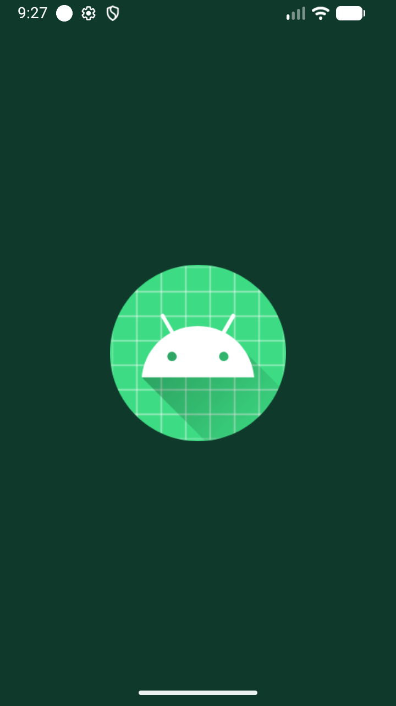 | 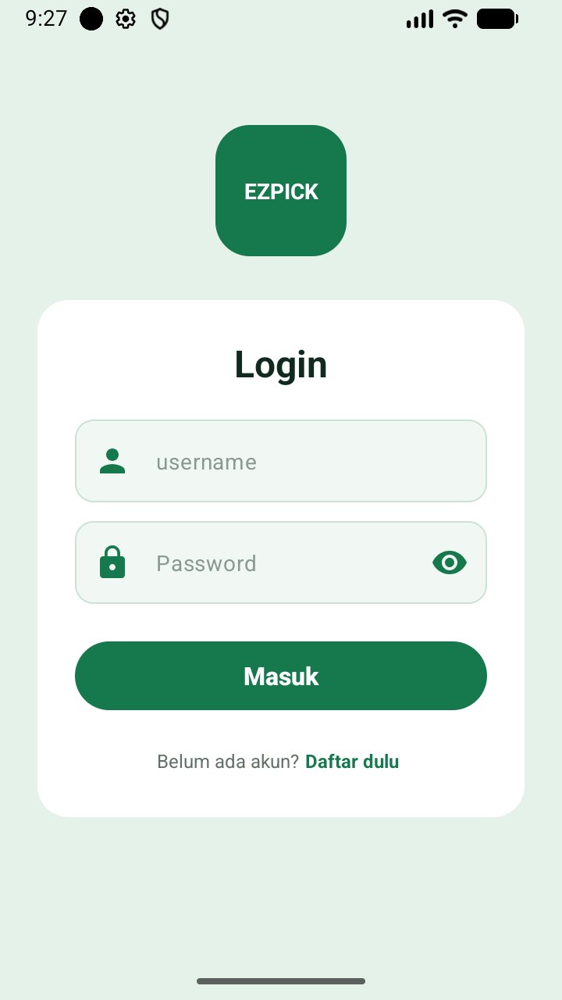 |
| `MainActivity` menampilkan Splash sekaligus memeriksa sesi login yang tersimpan | `LoginActivity` dengan kolom username dan password, serta navigasi menuju halaman Register |

| 06 — Register | 12 — Dashboard |
|:---:|:---:|
| 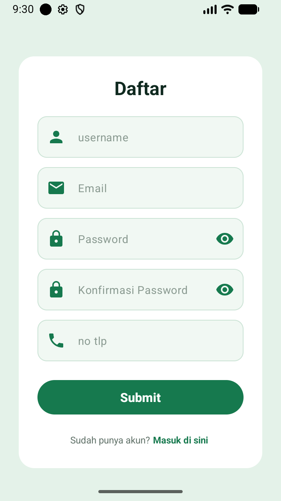 | 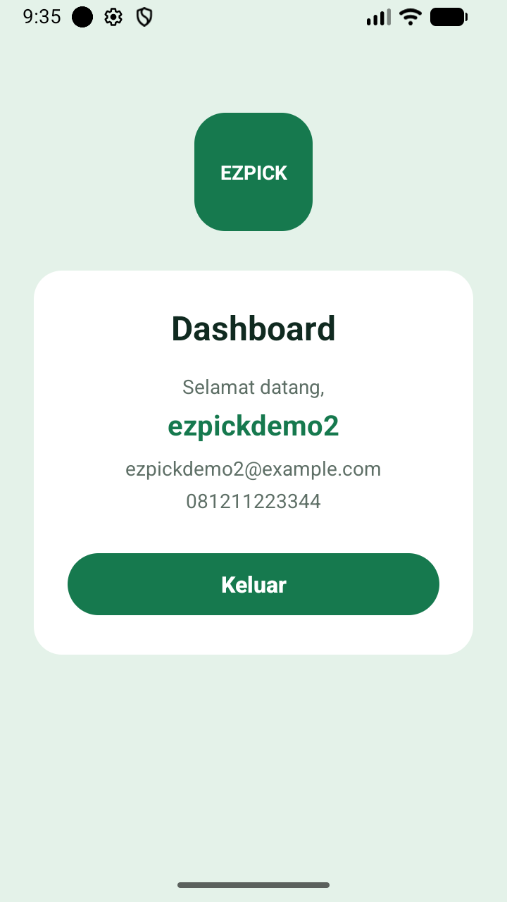 |
| `RegisterActivity` berisi username, email, password, konfirmasi password, dan nomor telepon | `DashboardActivity` menampilkan data akun yang dibaca dari sesi SharedPreferences |

### Validasi Form

| 03 — Validasi Login | 07 — Validasi Register |
|:---:|:---:|
| 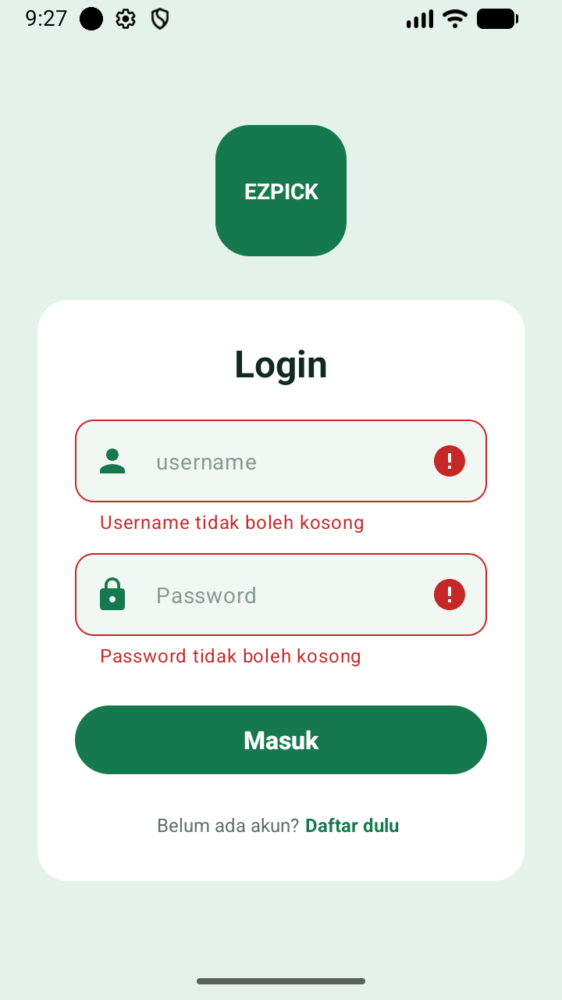 | 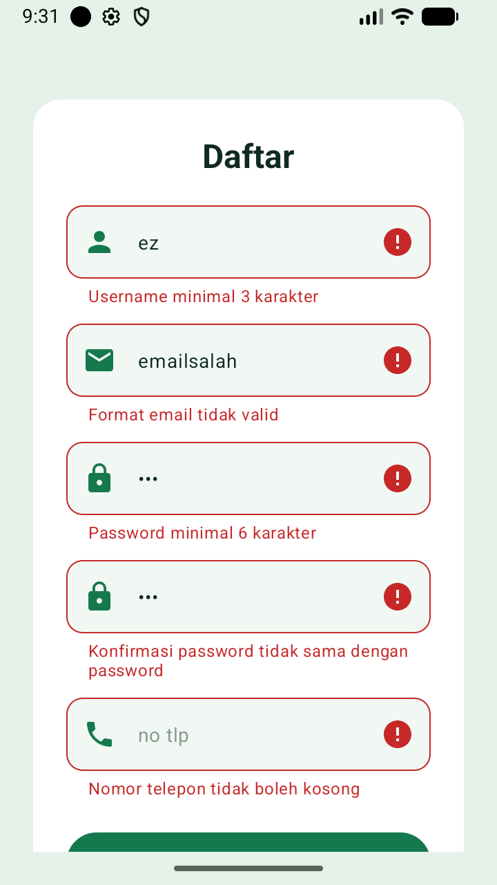 |
| Kolom kosong langsung ditandai merah beserta pesannya, dan permintaan tidak dikirim ke API | Seluruh kolom diperiksa sekaligus: username terlalu pendek, format email salah, password kurang dari 6 karakter, konfirmasi password berbeda, dan nomor telepon kosong |

### Status Loading

| 04 — Loading Login | 09 — Loading Register |
|:---:|:---:|
| 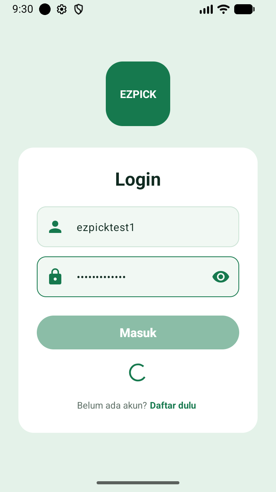 | 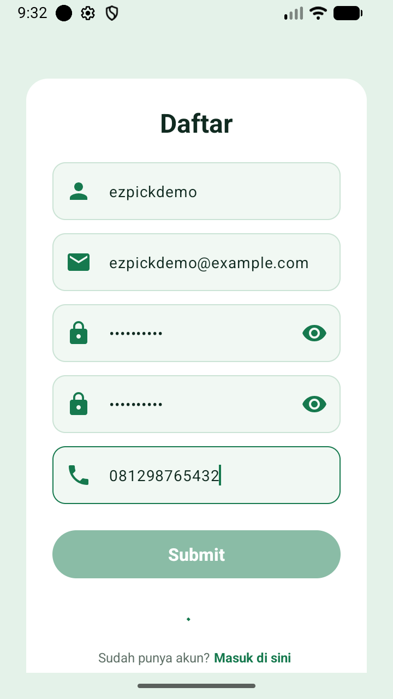 |
| Indikator loading tampil dan tombol **Masuk** dibuat pudar karena dinonaktifkan sementara | Tombol **Submit** ikut dinonaktifkan selama proses berlangsung, supaya data tidak terkirim dua kali |

### Proses Berhasil

| 08 — Form Register Terisi | 10 — Registrasi Berhasil |
|:---:|:---:|
| 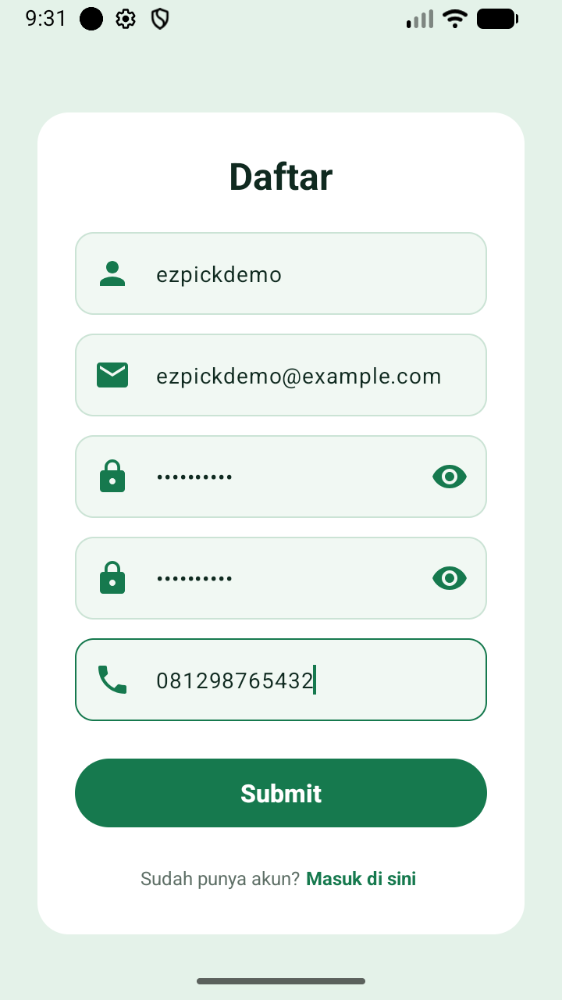 | 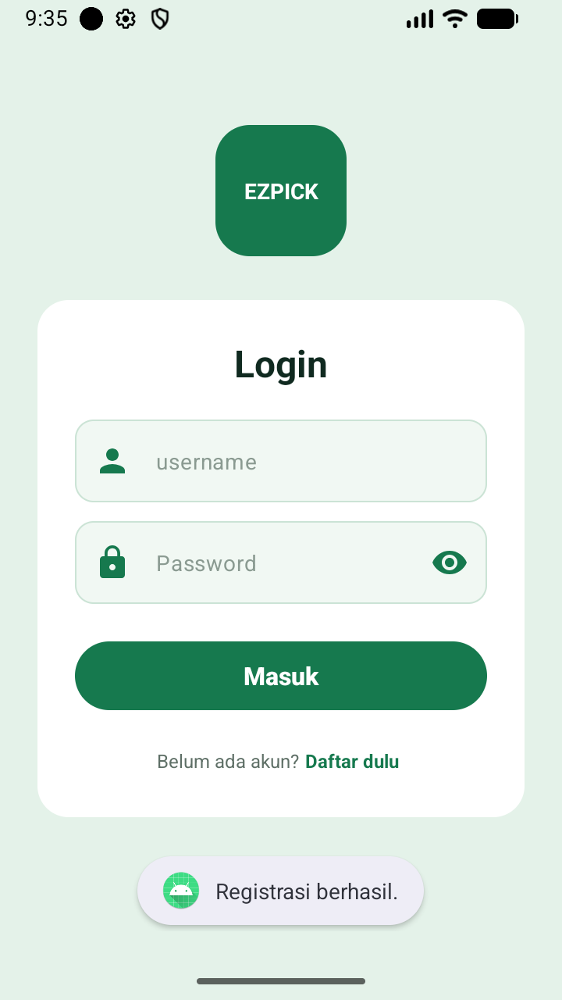 |
| Seluruh kolom sudah diisi dengan data yang benar dan siap dikirim ke API | Pesan "Registrasi berhasil." berasal dari server, lalu aplikasi kembali ke halaman Login |

| 13 — Sesi Masih Aktif | 14 — Setelah Keluar |
|:---:|:---:|
| 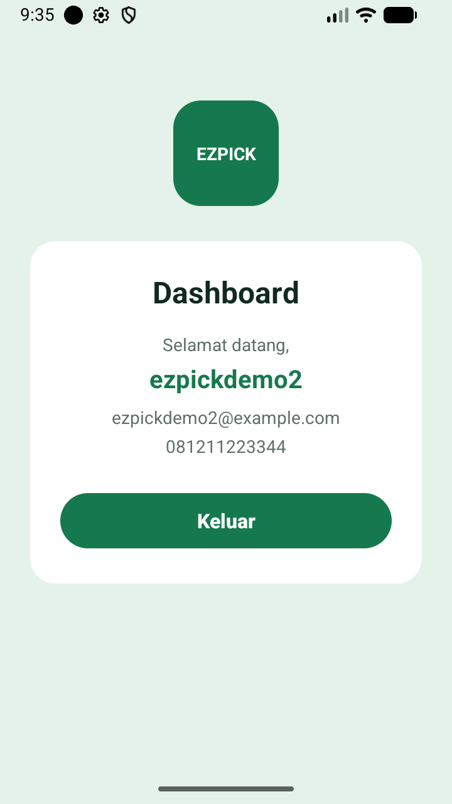 | 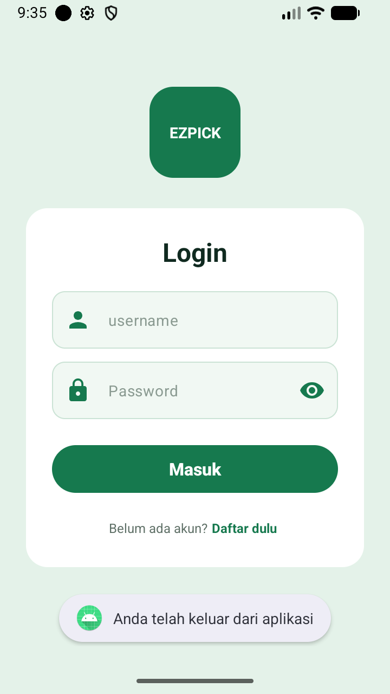 |
| Aplikasi ditutup lalu dibuka lagi, dan langsung masuk ke Dashboard tanpa login ulang | Menekan **Keluar** menghapus sesi, sehingga pengguna kembali ke halaman Login |

### Penanganan Error

| 05 — Login Gagal | 11 — Akun Sudah Terdaftar |
|:---:|:---:|
| 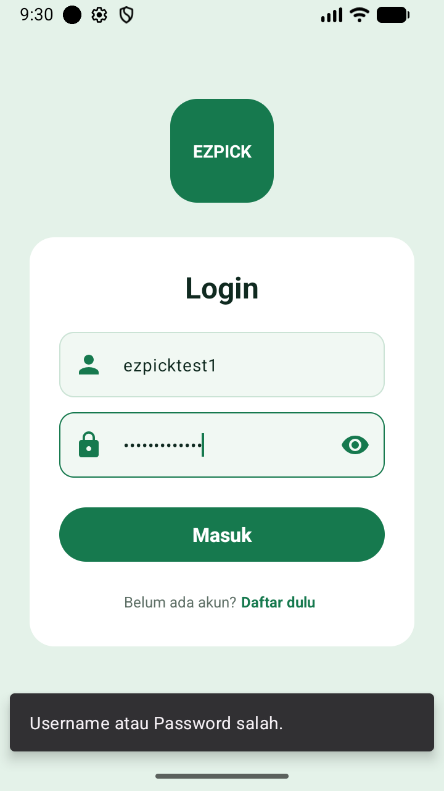 | 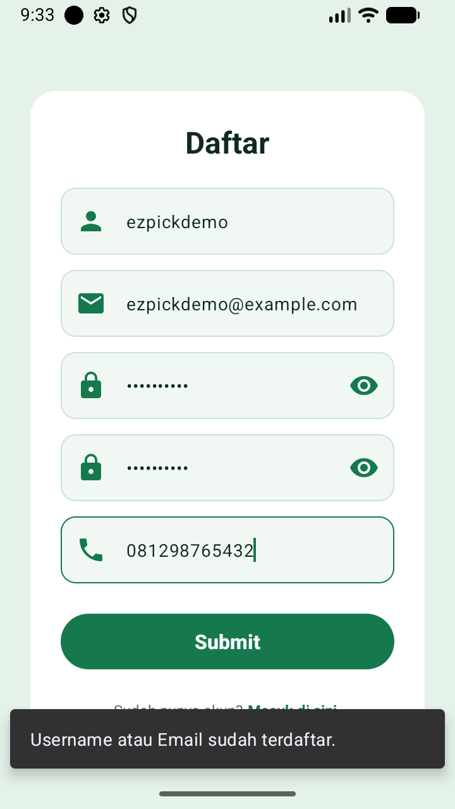 |
| Pesan "Username atau Password salah." dikirim server dengan kode HTTP 401, lalu dibaca dari `errorBody()` | Pesan "Username atau Email sudah terdaftar." dikirim server dengan kode HTTP 400 |

| 15 — Tanpa Koneksi Internet | |
|:---:|:---:|
| 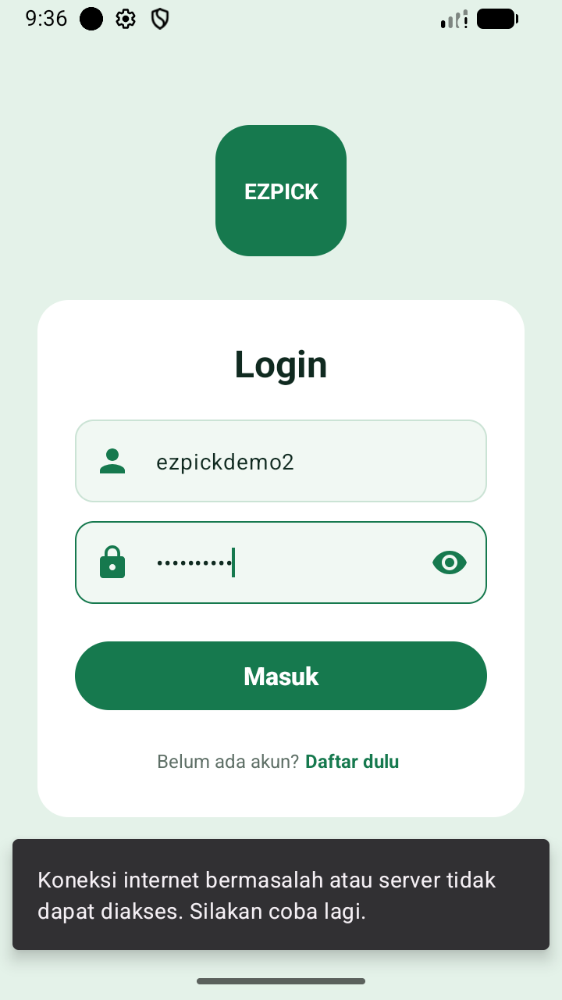 | |
| Koneksi dimatikan lalu Login ditekan. Aplikasi menampilkan pesan yang mudah dipahami dan tetap berjalan, tidak berhenti mendadak | |

## Catatan

- Endpoint autentikasi memakai **form**, bukan JSON. Mengirim body JSON ke `auth/login` akan ditolak server dengan pesan "Username dan Password wajib diisi.", walaupun isinya sudah lengkap.
- Respons gagal dikirim memakai kode **HTTP 400 dan 401**, sehingga pesannya harus dibaca dari `errorBody()`. Bila hanya mengandalkan `response.body()`, pesan dari server tidak akan pernah sampai ke pengguna.
- API ini **tidak menyediakan token**. Karena itu sesi yang disimpan berupa status login beserta data pengguna yang dikirim API. Bila suatu saat backend mulai mengirim token, cukup menambahkan satu kunci baru pada `UserRepository` tanpa mengubah susunan MVVM-nya.
- Halaman **Login memakai username**, bukan email, karena itulah yang diminta endpoint `auth/login` dan yang tertera pada desain. Validasi format email tetap diterapkan pada halaman Register, sesuai ketentuan tugas.
- Kolom **Konfirmasi Password** tidak ada pada gambar desain, tetapi tetap dibuat karena merupakan ketentuan wajib pada tugas ini. Kolom tersebut hanya dipakai untuk memeriksa kecocokan di sisi aplikasi dan **tidak ikut dikirim** ke API.
- **DashboardActivity** dibuat sebagai halaman tujuan setelah Login berhasil. Isinya sengaja dibuat sederhana karena fokus tugas ini ada pada autentikasi, bukan pada isi Dashboard.
- Pesan gagal ditampilkan memakai **Snackbar** ketika pengguna masih berada di halaman yang sama, dan memakai **Toast** ketika halaman langsung berpindah, karena Snackbar ikut hilang bersama halaman yang ditutup.
- Backend **tidak memeriksa format email maupun panjang password**. Pemeriksaan tersebut sepenuhnya dikerjakan di sisi aplikasi lewat ViewModel, sehingga data yang dikirim ke server sudah rapi lebih dulu.
- Aturan **R8** ditambahkan pada `app/src/main/keepRules/rules.keep` supaya model respons API tidak ikut dihapus saat build release, karena Gson membacanya lewat refleksi.
