# Toko-Online-Umkm

Repository kumpulan tugas magang di Crocodic Semarang untuk aplikasi **Toko Online UMKM Semarang (EZPICK)**. Branch ini berisi **Tugas 4**.

Seluruh tangkapan layar pada dokumen ini diambil langsung dari aplikasi yang sudah berjalan, memakai REST API yang sebenarnya.

---

# Branch `Tugas 4 – Implementasi API: Halaman Home dan Detail Produk`

## Deskripsi

Melanjutkan pengembangan aplikasi **Toko Online UMKM Semarang (EZPICK)** dengan menampilkan **daftar produk pada halaman Home (Beranda)** dan **informasi lengkap satu produk pada halaman Detail Product**, seluruhnya diambil dari **REST API** tanpa data hardcode. Pengguna dapat menekan salah satu menu pada Beranda untuk membuka detailnya, lalu kembali lagi ke Beranda.

Selain itu, seluruh tampilan aplikasi disesuaikan dengan **gambar referensi desain** yang diberikan: bar atas (logo, pencarian, keranjang, foto profil), banner hijau "Klik, Pilih, Nikmati", bagian **Pilih Menu**, chip filter kategori, daftar menu dua kolom, halaman **Rekomendasi**, halaman **kategori** ("Beranda / Promo Spesial"), serta **pop up konfirmasi keluar**. Nama file layout ikut dirapikan agar sesuai nama halaman pada desain baru.

Arsitektur yang dipakai tetap **MVVM (Model–View–ViewModel)** dengan **Repository Pattern** dan **API Service** yang sudah ada sejak tugas sebelumnya, sehingga tidak ada implementasi pemanggilan API yang dibuat berulang:

- **Model** — `Product`, `Category`, `FavoriteItem`, dan model respons di `data/network/ResponseModels.kt`.
- **View** — `HomeFragment`, `RecommendationFragment`, `CategoryActivity`, `ProductDetailActivity`; hanya menampilkan data dan menerima interaksi.
- **ViewModel** — mengatur pengambilan data serta status *loading*, *berhasil*, *error*, dan *data kosong*.
- **Repository** — `ProductRepository` dan `FavoriteRepository`, satu-satunya bagian yang berbicara dengan `ApiService`.

## Ketentuan Fitur

- Daftar produk pada halaman Beranda diambil dari **`GET /api/products`**, bukan daftar yang ditulis di dalam kode.
- Detail produk diambil dari **`GET /api/products/{id}`** memakai **ID produk yang benar-benar dipilih pengguna**, bukan ID tetap.
- Memakai **MVVM + Repository Pattern**; Activity dan Fragment tidak pernah memanggil Retrofit secara langsung.
- Daftar menu memakai **RecyclerView** dua kolom, lengkap dengan **foto menu**, **nama**, dan **harga** berformat rupiah.
- Gambar produk ditampilkan dari **URL/path yang dikirim API**; bila produk belum punya foto atau foto gagal diunduh, ditampilkan **gambar pengganti**.
- Menekan sebuah menu membuka **halaman Detail Menu**, dan tombol kembali mengembalikan pengguna ke Beranda.
- Menangani **loading**, **berhasil**, **error**, **data kosong**, **produk tidak ditemukan**, **koneksi bermasalah**, dan **respons tidak sesuai format** dengan `try-catch` pada Repository.
- Daftar produk **tidak dimuat ulang tanpa alasan**: data hanya diambil saat halaman pertama kali dibuka atau ketika filter, pencarian, dan tombol **Coba lagi** ditekan.
- Nilai yang memang bersifat konfigurasi (base URL) tetap berada di `ApiConfig`, bukan tersebar di dalam kode halaman.

## Endpoint yang Dipakai

Seluruh endpoint sudah tersedia sejak Tugas 2 dan memakai bentuk respons yang sama (`{ status, message, data }`). Pada tugas ini **tidak ada perubahan pada backend**.

| Method | Endpoint | Dipakai oleh |
|---|---|---|
| GET | `/api/products` | Daftar menu pada Beranda dan hasil pencarian |
| GET | `/api/products?category_id=` | Chip filter pada Beranda dan halaman Kategori |
| GET | `/api/products?search=` | Kolom pencarian pada bar atas |
| GET | `/api/products?best_seller=1` | Bagian **Best Seller** pada halaman Rekomendasi |
| GET | `/api/products/{id}` | **Halaman Detail Menu** |
| GET | `/api/categories` | Bagian **Pilih Menu** dan chip filter |
| GET | `/api/favorites?user_id=` | Tombol **Favorit** pada Beranda |
| GET | `/api/carts?user_id=` | Angka merah pada ikon keranjang di bar atas |
| POST | `/api/carts` | Tombol **+ Keranjang** pada halaman Detail Menu |

Contoh respons `GET /api/products/1`:

```json
{
  "status": true,
  "message": "Detail produk ditemukan.",
  "data": {
    "id": 1,
    "category_id": 3,
    "category_name": "Menu Paket",
    "name": "Paket Chiken Katsu",
    "price": 25000,
    "image": "uploads/produk/paket-chiken-katsu.jpg",
    "is_best_seller": true,
    "is_available": true,
    "description": "Potongan ayam katsu berbalut tepung panko yang digoreng sampai renyah, disajikan bersama nasi hangat dan saus katsu khas EZPICK.",
    "created_at": "2026-10-12 05:29:06"
  }
}
```

Ketika ID tidak memiliki data, backend menjawab **HTTP 404** dengan `{"status": false, "message": "Produk tidak ditemukan."}`, dan pesan itulah yang ditampilkan aplikasi.

## Alur

**Halaman Beranda**

```
HomeFragment → HomeViewModel → ProductRepository → GET /api/products → MySQL
     ^                                                                  |
     +---------------- daftar menu ditampilkan -------------------------+
```

**Detail Menu**

```
Menekan kartu menu pada Beranda
   → ID produk dikirim lewat ProductDetailActivity.buatIntent(context, idProduk)
   → ProductDetailViewModel.muatDetail(id)
   → ProductRepository.ambilDetailProduk(id)
   → GET /api/products/{id}
        ├─ Berhasil        : foto, nama, harga, kategori, dan deskripsi ditampilkan
        ├─ 404             : pesan "Produk tidak ditemukan."
        └─ Gangguan koneksi : pesan koneksi + tombol "Coba lagi"
   → Tombol kembali pada bar atas mengembalikan pengguna ke Beranda
```

**MVVM**

```
View (Fragment/Activity) → ViewModel → Repository → ApiService → Backend REST API
       ^                                                              |
       +------------------- LiveData diperbarui ----------------------+
```

## Penyesuaian Desain

Seluruh layout disesuaikan dengan gambar referensi, dan nama filenya dirapikan mengikuti nama halaman pada desain baru.

**Nama file layout yang diganti**

| Nama lama | Nama baru |
|---|---|
| `activity_main.xml` | `activity_splash.xml` |
| `fragment_home.xml` | `fragment_beranda.xml` |
| `item_product.xml` | `item_produk.xml` (dirombak menjadi kartu dua kolom) |
| `item_cart.xml` | `item_keranjang.xml` |
| `item_order.xml` | `item_pesanan.xml` |
| `activity_edit_profile.xml` | `activity_edit_profil.xml` |

Agar penamaan konsisten, `MainActivity` juga diubah menjadi **`SplashActivity`** mengikuti nama halaman 01 pada desain.

**Layout baru**

| File | Halaman pada desain |
|---|---|
| `layout_bar_atas.xml` | Bar atas: logo, pencarian, keranjang + jumlah item, foto profil |
| `layout_bar_kembali.xml` | Bar atas bertombol kembali ("Beranda / Promo Spesial") |
| `fragment_rekomendasi.xml` | 05 — Rekomendasi |
| `activity_kategori.xml` | 06 — Promo Spesial (Kategori) |
| `activity_detail_produk.xml` | Detail Menu |
| `dialog_konfirmasi_logout.xml` | Overlay — Konfirmasi Log out |
| `item_kategori.xml`, `item_chip_kategori.xml` | Kartu "Pilih Menu" dan chip filter |
| `activity_riwayat.xml` | Wadah halaman Riwayat Pesanan |

**Bottom Navigation** disesuaikan dengan desain menjadi **Beranda · Rekomendasi · Keranjang · Profil**. Menu **Riwayat** yang sebelumnya berada di sana tetap dipertahankan dan kini dibuka lewat pintasan **Riwayat Pesanan** pada halaman Profil, sehingga tidak ada fitur yang hilang.

## File yang Ditambahkan / Diubah

**Backend**

- `backend/database/seed_produk.sql` — **baru**. Mengisi kolom `image` dan `description` seluruh menu, serta menambah 3 menu untuk kategori Promo Spesial.
- `backend/public/uploads/produk/` — **baru**. Berisi 11 gambar menu yang dilayani sebagai berkas statis.

**Android — data**

- `data/network/ResponseModels.kt` — tambah field `image` dan `created_at` pada `Product`, tambah `ProductDetailResponse`, `FavoriteItem`, dan `FavoriteListResponse`.
- `data/network/ApiService.kt` — tambah `getProductDetail()`, parameter `best_seller` pada `getProducts()`, dan `getFavorites()`.
- `data/repository/ProductRepository.kt` — tambah `ambilDetailProduk()` serta penyaringan kategori, pencarian, dan best seller pada `ambilProduk()`.
- `data/repository/FavoriteRepository.kt` — **baru**.
- `data/repository/UserRepository.kt` — `unduhAvatar()` kini memakai `PemuatGambar` yang sama dengan foto menu.

**Android — util**

- `util/PemuatGambar.kt` — **baru**. Pengunduh gambar bersama beserta cache sederhana, dipakai foto menu dan foto profil.
- `util/Format.kt` — format harga mengikuti desain menjadi `Rp. 15.000`.

**Android — tampilan**

- `ui/home/HomeFragment.kt` & `HomeViewModel.kt` — halaman Beranda baru (kategori, chip filter, pencarian, favorit, daftar menu).
- `ui/home/CategoryAdapter.kt`, `ui/home/CategoryFilterAdapter.kt` — **baru**.
- `ui/product/ProductAdapter.kt` — **baru** (pindah dari `ui/home`), kartu menu dua kolom yang dipakai bersama tiga halaman.
- `ui/product/ProductDetailActivity.kt` & `ProductDetailViewModel.kt` — **baru**, halaman Detail Menu.
- `ui/recommendation/RecommendationFragment.kt` & `RecommendationViewModel.kt` — **baru**.
- `ui/category/CategoryActivity.kt` & `CategoryViewModel.kt` — **baru**.
- `ui/history/HistoryActivity.kt` — **baru**, wadah halaman Riwayat Pesanan.
- `ui/common/BarAtas.kt` & `ui/common/BarAtasViewModel.kt` — **baru**, pengatur bar atas yang dipakai bersama Beranda dan Rekomendasi.
- `ui/dashboard/DashboardActivity.kt` — menu Bottom Navigation baru + `pilihMenu()`.
- `ui/profile/ProfileFragment.kt` — pop up konfirmasi keluar dan pintasan Riwayat Pesanan.
- `SplashActivity.kt` — ganti nama dari `MainActivity.kt`.
- Layout, drawable, warna, style, string, dan `AndroidManifest.xml` menyesuaikan desain baru.

## Penanganan Kondisi

| Kondisi | Yang ditampilkan |
|---|---|
| Sedang memuat | Indikator loading; pesan lama disembunyikan |
| Berhasil | Daftar menu / detail menu sesuai respons API |
| Data kosong | "Belum ada menu yang tersedia." (Beranda), "Belum ada menu pada kategori ini." (Kategori), "Belum ada menu favorit." (mode Favorit) |
| Produk tidak ditemukan | Pesan dari server: "Produk tidak ditemukan." |
| Request gagal | Pesan dari server + tombol **Coba lagi** |
| Koneksi bermasalah / server mati | "Koneksi internet bermasalah atau server tidak dapat diakses. Silakan coba lagi." |
| Respons tidak sesuai format | "Respons dari server tidak sesuai. Silakan coba beberapa saat lagi." — aplikasi tidak berhenti mendadak |
| Foto menu belum ada / gagal dimuat | Kotak gambar pengganti bertuliskan "foto menu" |
| Stok habis (`is_available: false`) | Penanda **STOK HABIS** pada foto, dan tombol **+ Keranjang** dinonaktifkan |

Aplikasi **tidak pernah** menampilkan data seolah-olah berhasil dimuat ketika request API sebenarnya gagal.

## Melengkapi Katalog Menu

Sebelumnya kolom `image` dan `description` pada tabel `products` masih kosong untuk seluruh menu, dan kategori **Promo Spesial** belum memiliki satu pun produk. Keduanya kini dilengkapi supaya foto serta deskripsi yang tampil di aplikasi benar-benar berasal dari database.

| Yang dilengkapi | Keterangan |
|---|---|
| Kolom `image` | Diisi path relatif, contoh `uploads/produk/miso-ramen.jpg`, mengikuti pola yang dipakai foto profil pada Tugas 3 |
| Kolom `description` | Diisi deskripsi singkat untuk tiap menu, ditampilkan pada halaman Detail Menu |
| Kategori **Promo Spesial** | Ditambah 3 menu paket hemat: Paket Hemat Berdua (Rp. 35.000), Promo Geprek + Es Teh (Rp. 18.000), dan Paket Katsu Komplit (Rp. 28.000) |

Perubahannya dicatat pada **`backend/database/seed_produk.sql`** sehingga bisa dijalankan ulang di komputer lain:

```
mysql -u root db_toko_online < backend/database/seed_produk.sql
```

Berkas tersebut aman dijalankan berulang kali: `UPDATE` memakai ID yang sudah ada, sedangkan `INSERT` memeriksa nama menu lebih dulu supaya menu promo tidak terduplikasi, dan `category_id` diambil dari tabel `categories` (bukan angka tetap).

File gambarnya disimpan di **`backend/public/uploads/produk/`** dan dilayani sebagai berkas statis di luar `/api`, contoh alamat lengkapnya `http://10.0.2.2:3000/uploads/produk/miso-ramen.jpg`.

> Gambar menu saat ini berupa **ilustrasi** yang dibuat memakai palet warna EZPICK, bukan foto makanan asli. Ketika foto asli sudah tersedia, cukup ganti berkas di folder tersebut atau perbarui kolom `image` — tidak ada kode Android yang perlu diubah.

Catatan lain agar tampilan tetap jujur terhadap isi database:

- **Teh Tawar** dan **Katsu Sandwich** memang berstatus `is_available = 0`, jadi keduanya ditandai **STOK HABIS** dan tidak bisa dimasukkan ke keranjang.
- Bagian **Harga Terjangkau** pada halaman Rekomendasi tidak memakai daftar tetap, melainkan diurutkan dari harga termurah pada data `GET /api/products` yang stoknya masih ada.
- Kalau nanti ada menu baru yang kolom `image` atau `description`-nya masih kosong, aplikasi tetap aman: yang tampil kotak gambar pengganti dan keterangan "Deskripsi menu belum tersedia.".

## Cara Menguji

1. Jalankan MySQL, lalu isi katalog menu sekali saja: `mysql -u root db_toko_online < backend/database/seed_produk.sql`.
2. Jalankan backend: `php -S 0.0.0.0:3000 -t backend/public`.
3. Jalankan aplikasi lalu login.
4. **Beranda** menampilkan kategori dan daftar menu dari API. Coba tekan chip kategori, ketik kata kunci pada kolom pencarian, dan tekan tombol **Favorit**.
5. Tekan salah satu kartu menu untuk membuka **Detail Menu**, lalu tekan tombol kembali untuk kembali ke Beranda.
6. Tekan salah satu kartu pada **Pilih Menu** untuk membuka halaman kategori.
7. Buka tab **Rekomendasi** untuk melihat bagian Best Seller dan Harga Terjangkau.
8. Matikan backend lalu tekan **Coba lagi** untuk memastikan pesan koneksi muncul dan aplikasi tetap berjalan.
9. Buka tab **Profil** lalu tekan **Keluar** untuk melihat pop up konfirmasi.

Endpoint juga bisa diuji lewat Postman memakai collection `postman/Toko-Online-UMKM-Semarang.postman_collection.json`.

## Tangkapan Layar

Seluruh gambar diambil dari aplikasi yang berjalan di emulator dan terhubung ke backend lokal, sehingga data yang terlihat benar-benar berasal dari database `db_toko_online`.

| 27 — Beranda | 28 — Daftar Menu |
|:---:|:---:|
| 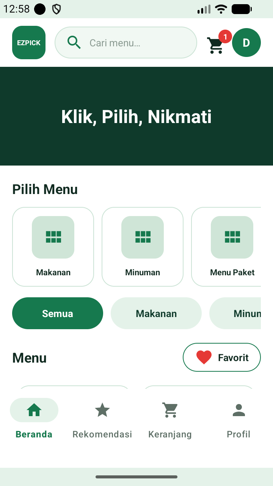 | 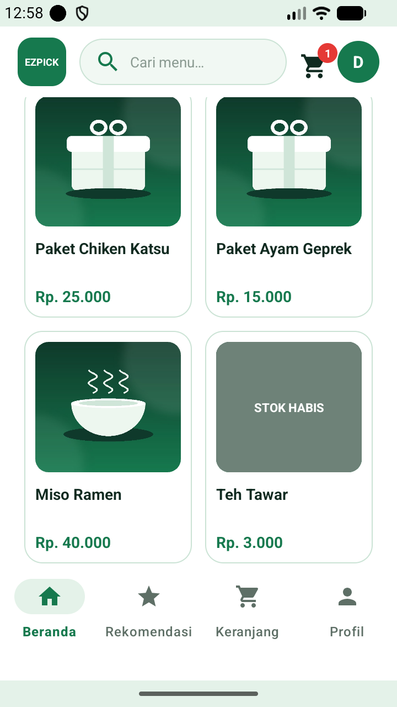 |
| Bar atas, banner, bagian **Pilih Menu** berisi kategori dari `GET /api/categories`, chip filter, dan judul bagian **Menu** | Kartu menu dua kolom hasil `GET /api/products`, lengkap dengan foto dari kolom `image`. Menu yang `is_available`-nya `false` ditandai **STOK HABIS** |

| 29 — Detail Menu | 30 — Tambah ke Keranjang |
|:---:|:---:|
|  | 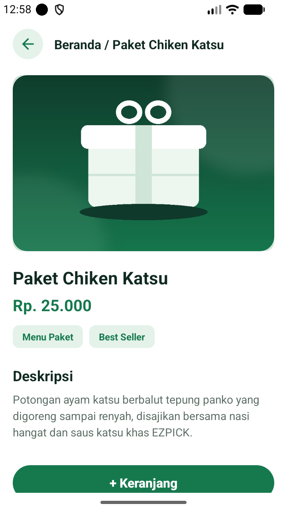 |
| Hasil `GET /api/products/{id}` memakai ID menu yang dipilih: foto, nama, harga, kategori, label Best Seller, dan deskripsi | Tombol **+ Keranjang** mengirim `POST /api/carts` dan menampilkan pesan dari server |

| 31 — Kembali ke Beranda | 32 — Rekomendasi (Best Seller) |
|:---:|:---:|
|  | 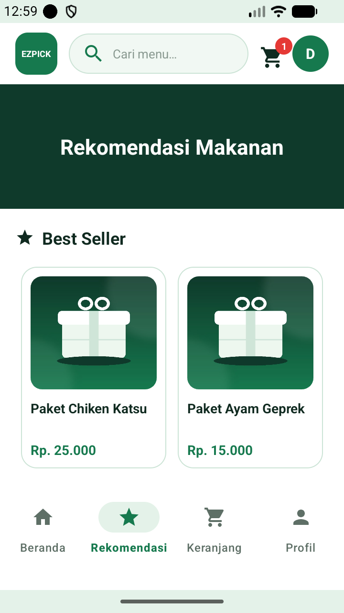 |
| Tombol kembali mengembalikan pengguna ke Beranda. Daftar menu **tidak dimuat ulang**, dan angka pada ikon keranjang bertambah menjadi 1 | Bagian **Best Seller** diambil dari `GET /api/products?best_seller=1` |

| 33 — Rekomendasi (Harga Terjangkau) | 34 — Kategori |
|:---:|:---:|
| 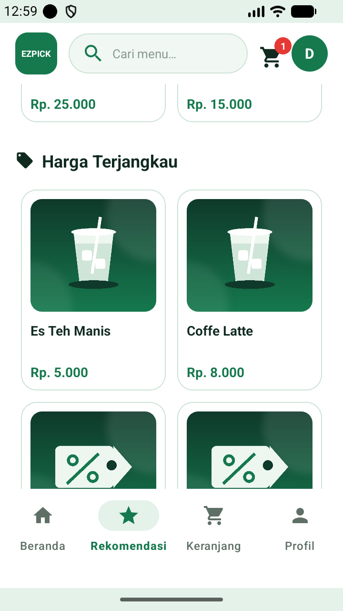 | 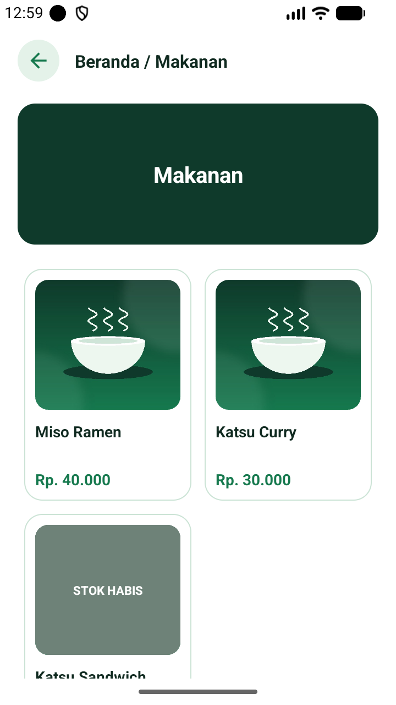 |
| Menu termurah yang stoknya masih ada, diurutkan dari data `GET /api/products` | Halaman "Beranda / Makanan" memakai `GET /api/products?category_id=1` |

| 35 — Kategori Promo Spesial | 36 — Pencarian |
|:---:|:---:|
| 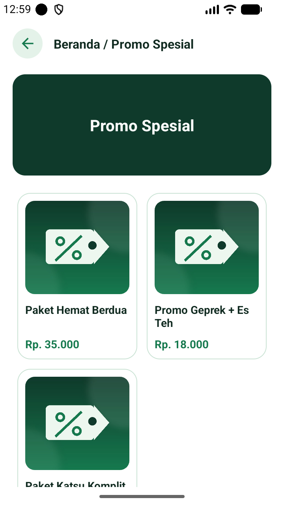 | 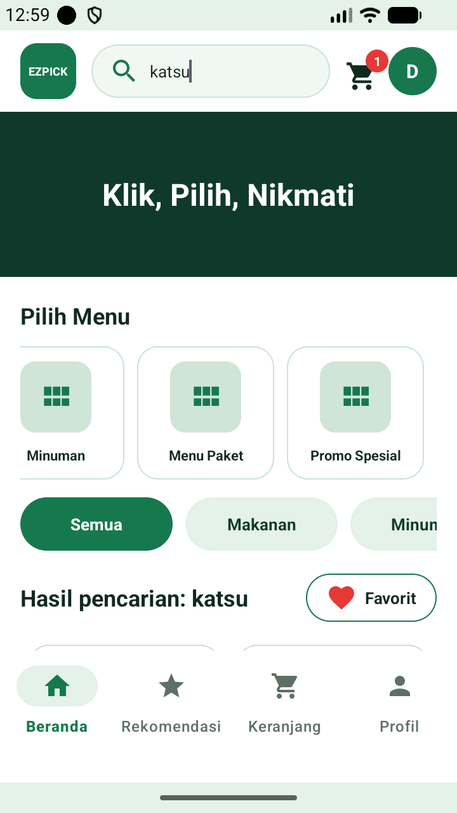 |
| Tiga menu promo yang baru ditambahkan pada kategori ini, diambil lewat `GET /api/products?category_id=4` | Kata kunci dikirim lewat `GET /api/products?search=katsu`, judul bagian ikut menyesuaikan |

| 37 — Favorit | 38 — Pintasan Riwayat pada Profil |
|:---:|:---:|
| 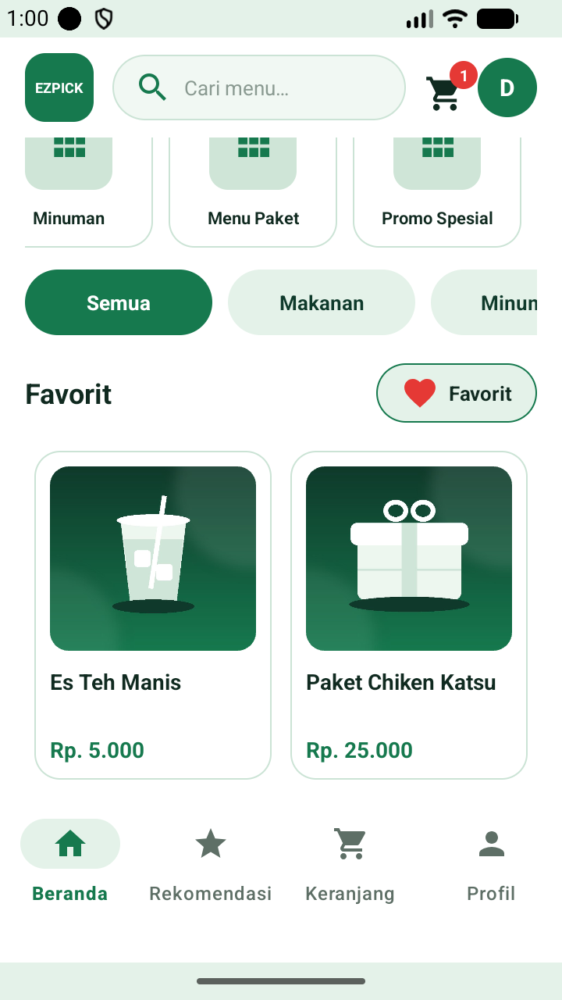 | 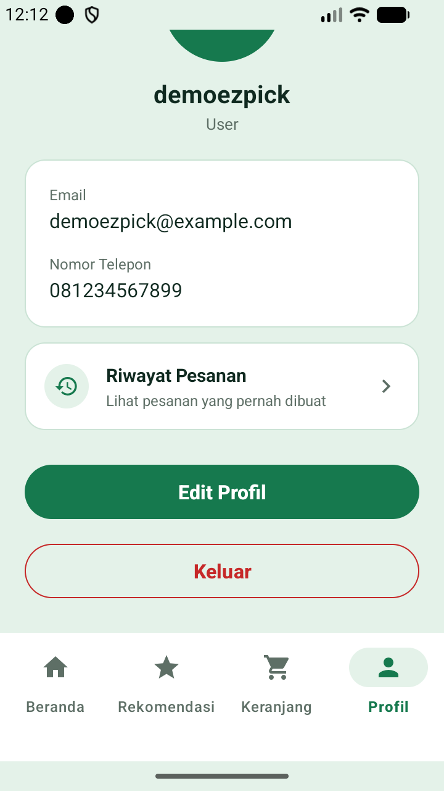 |
| Tombol **Favorit** menampilkan menu favorit pengguna dari `GET /api/favorites?user_id=` | Menu Riwayat yang sebelumnya ada di Bottom Navigation kini dibuka dari halaman Profil |

| 39 — Konfirmasi Keluar | 40 — Riwayat Pesanan |
|:---:|:---:|
| 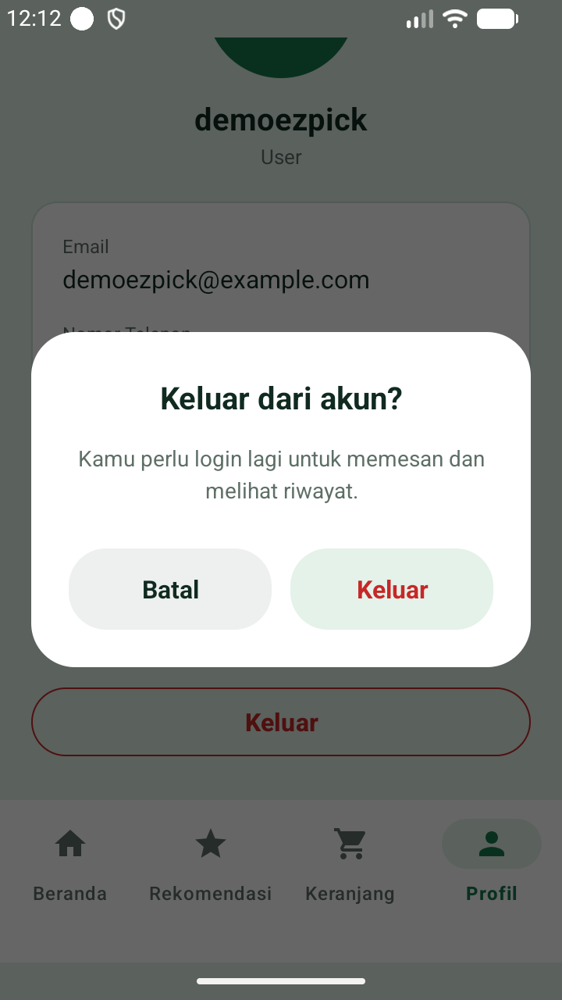 | 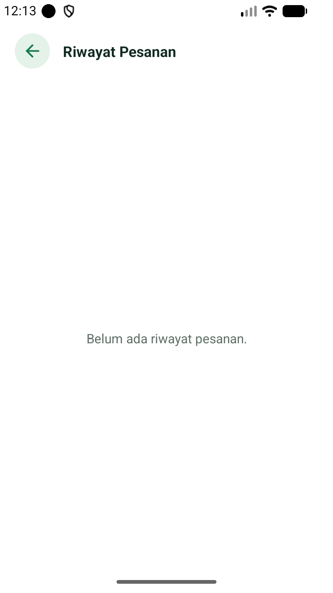 |
| Pop up konfirmasi sesuai gambar referensi. Sesi baru dihapus setelah tombol **Keluar** ditekan | Halaman Riwayat Pesanan tetap berfungsi seperti sebelumnya |

| 41 — Server Tidak Dapat Diakses |
|:---:|
| 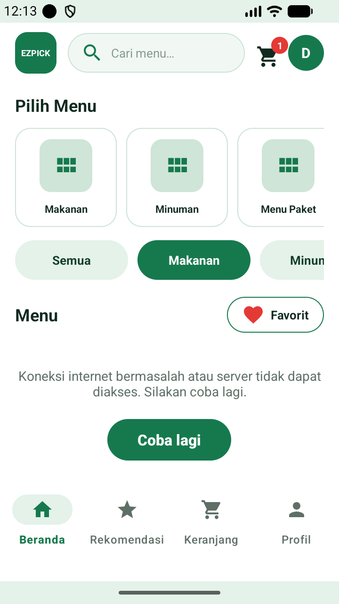 |
| Backend sengaja dimatikan. Aplikasi menampilkan pesan koneksi beserta tombol **Coba lagi**, tidak menampilkan data lama seolah-olah berhasil dimuat, dan tetap berjalan tanpa berhenti mendadak |
